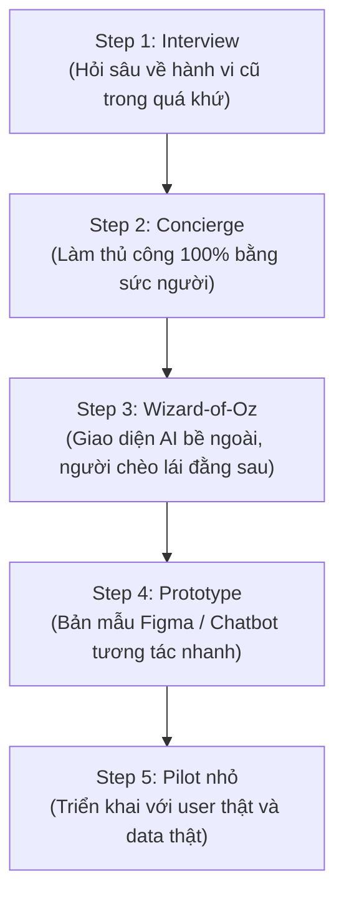

# 2026-09-14 — VinUni - Workshop Tối Day 04: Xây Dựng AI MVP

## Main thread of today

* **Trọng tâm:** Workshop Chuyên đề Tối Day 04 (8:00 PM – 10:00 PM) — Phương pháp luận thiết kế, định vị và thẩm định **AI MVP (Minimum Viable Product)** trong chương trình **AI Thực chiến VinUni (K4A)**.
* **Chi tiết kiến thức hệ thống hóa:** [[Workshop - Xây dựng AI MVP]] (Dự án [[VinUni - Chương trình Đào tạo AI Thực chiến]])

---

## What did I learn today?

* **Khung sườn 5 bước (Core Framework):** $\text{Persona} \rightarrow \text{Problem} \rightarrow \text{AI Leverage} \rightarrow \text{MVP Scope} \rightarrow \text{Metric}$.
* **Persona sắc bén:** Persona càng hẹp thì quyết định sản phẩm càng sắc bén. Giá trị lớn nhất của Persona là giúp người làm sản phẩm biết **nên bỏ gì** và **tập trung build gì**.
* **Problem gốc vs. Triệu chứng bề mặt:** Triệu chứng chỉ là biểu hiện nhìn thấy (lười biếng, tốn thời gian, quên việc); Problem gốc là nguyên nhân cơ chế (thiếu môi trường duy trì hành vi, quy trình thủ công lặp lại, thiếu thông tin đúng lúc).
* **Công thức Problem Statement 5 thành phần:** `[Persona] gặp khó khăn khi [Job-to-be-done] trong bối cảnh [Context], hiện họ đang [Current workaround], dẫn đến [Negative outcome]`.
* **AI Leverage Map:** Phân định rõ AI tạo giá trị ở đâu qua 4 ô: Tốc độ (*Speed*), Độ chính xác (*Decision*), Cá nhân hóa (*Personalization*), và kiểm tra xem AI có thực sự cần thiết hay chỉ là lớp trang trí (*Gimmick*).
* **AI không phải là Value Proposition:** Người dùng không mua công nghệ AI; họ mua kết quả đầu ra (*Outcome*). Không bao giờ tuyên bố giá trị bằng câu *"chúng tôi là app dùng AI"*.
* **Radar 6 yếu tố thẩm định AI Feasibility:** Kiểm tra Data, Accuracy (ngân sách lỗi), Latency, Cost (unit economics), Trust, và Human-in-the-loop trước khi bắt tay vào code.
* **AI MVP Canvas & Thang kiểm chứng (Validation Ladder):** 10 ô canvas tinh gọn trên 1 trang giấy kết hợp lộ trình kiểm chứng 5 nấc (*Interview $\rightarrow$ Concierge $\rightarrow$ Wizard-of-Oz $\rightarrow$ Prototype $\rightarrow$ Pilot nhỏ*).
* **AI MVP Scorecard:** Bộ 6 câu hỏi chất vấn ý tưởng. *"Idea tốt không phải là idea hoành tráng, mà là idea có thể kiểm chứng nhanh và cắt bỏ sai lầm nhanh."*

---

# Workshop: Xây Dựng AI MVP

> [!NOTE] **Khung sườn Thiết kế Chỉ đạo (Core Framework)**
> $$\text{Persona} \longrightarrow \text{Problem} \longrightarrow \text{AI Leverage} \longrightarrow \text{MVP Scope} \longrightarrow \text{Metric}$$
> * **Persona:** Nhóm người dùng đủ hẹp để ra quyết định cắt giảm tính năng.
> * **Problem:** Problem Statement rõ ràng, bóc tách đến tận nguyên nhân gốc rễ.
> * **AI Leverage:** Chỉ rõ AI tạo khác biệt thực sự ở đâu thay vì làm màu.
> * **MVP Scope:** Phạm vi nhỏ nhất khả dĩ để minh chứng giá trị cốt lõi.
> * **Metric:** Thước đo đánh giá value nhận được thay vì đo sự tò mò nhất thời.

---

## 1. Persona Tốt Giúp Ra Quyết Định

![[Pasted image 20260914133637.png]]

* **Bản chất:** Persona càng hẹp, quyết định sản phẩm càng sắc bén.
* Khi nhóm người dùng mục tiêu quá rộng (ví dụ: "tất cả sinh viên" hay "người đi làm"), sản phẩm sẽ rơi vào cái bẫy "làm hài lòng tất cả nhưng không ai thực sự cần".
* **5 Câu hỏi quyết định mà một Persona sắc bén giải quyết được:**
  1. **Nên build gì?** — Xác định tính năng sống còn phục vụ đúng hoàn cảnh của họ.
  2. **Nên bỏ gì?** — Cắt bỏ mọi tính năng rườm rà không trực tiếp phục vụ mục tiêu.
  3. **Nên đo lường gì?** — Chọn đúng metric phản ánh sự thành công của họ.
  4. **Nên phỏng vấn ai?** — Xác định chính xác đối tượng cần tiếp cận để lấy insight thật.
  5. **Nên thiết kế trải nghiệm ra sao?** — Điều chỉnh giao diện, tông giọng và friction phù hợp thói quen sử dụng.

---

## 2. Bóc Tách Vấn Đề: Problem Không Phải Là Triệu Chứng

![[Pasted image 20260914133647.png]]

* Sai lầm lớn nhất của các kỹ sư AI là **giải quyết triệu chứng bề nổi** thay vì đào sâu vào bài toán gốc rễ.
* Bảng đối chiếu giữa Hiện tượng quan sát được và Căn nguyên cơ chế:

| Triệu chứng (Thứ nhìn thấy bề mặt) | Problem Gốc (Thứ phải đào sâu giải quyết) |
|---|---|
| Người học lười biếng. | **Thiếu môi trường duy trì hành vi** (thiếu bạn đồng hành, thiếu cam kết xã hội). |
| Giáo viên mất nhiều thời gian. | **Quy trình thủ công bị lặp lại** (chấm các lỗi cơ bản, tổng hợp báo cáo thủ công). |
| Sales quên follow-up khách hàng. | **Thiếu thông tin đúng lúc để ra quyết định** (dữ liệu CRM rời rạc, không có prompt nhắc đúng điểm rơi). |
| Khách hàng không quay lại. | **Không có trigger đủ mạnh để kéo họ trở lại** (giá trị nhận được một lần chưa đủ gắn kết). |

---

## 3. Công Thức Problem Statement Chuẩn Mực

![[Pasted image 20260914133656.png]]

> [!TIP] **Khẩu quyết**
> *"Viết đúng nỗi đau trước khi viết prompt."*

### 3.1. Cấu trúc Công thức 5 thành phần:
```text
[Persona] gặp khó khăn khi [Job-to-be-done]
trong bối cảnh [Context], hiện họ đang
[Current workaround], dẫn đến [Negative outcome].
```

### 3.2. Ví dụ Phân tích Thực tế (Case Study Tự Học Buổi Tối)
![[Pasted image 20260914133703.png]]

* **Persona:** `[Sinh viên 18–24]`
* **Job-to-be-done:** `[tự học một mình vào buổi tối]`
* **Context:** `[có quá nhiều yếu tố gây xao nhãng (mạng xã hội, điện thoại, môi trường)]`
* **Current workaround:** `[bật video study-with-me, dùng Pomodoro rời rạc hoặc rủ bạn học cùng qua Discord]`
* **Negative outcome:** `[mất tập trung, học không đều và giảm động lực duy trì đường dài]`.

---

## 4. Bản Đồ Đòn Bẩy AI (AI Leverage Map)

![[Pasted image 20260914133707.png]]

AI không phải chiếc đũa thần cho mọi vấn đề. Cần định vị chính xác AI tạo giá trị qua Ma trận 4 ô:

```text
┌──────────────────────────────────────┬──────────────────────────────────────┐
│  1. TỐC ĐỘ (Speed / Efficiency)      │  2. CHÍNH XÁC (Decision Support)     │
│  AI giúp người dùng làm việc gì      │  AI giúp quyết định nào              │
│  nhanh hơn gấp nhiều lần?            │  chính xác hơn?                      │
├──────────────────────────────────────┼──────────────────────────────────────┤
│  3. CÁ NHÂN HÓA (Personalization)    │  4. KIỂM TRA THỰC CHẤT (Necessity)   │
│  AI giúp trải nghiệm nào             │  AI có thật sự cần thiết không       │
│  may đo riêng cho từng người dùng?   │  hay chỉ là lớp trang trí (gimmick)? │
└──────────────────────────────────────┴──────────────────────────────────────┘
```

* **Ô 4 là bộ lọc sống còn:** Nếu một logic `If-Else`, một rule nghiệp vụ hoặc một form khảo sát đơn giản giải quyết được 80% vấn đề với chi phí rẻ hơn và độ ổn định cao hơn, **tuyệt đối không đưa LLM vào chỉ để "nghe cho ngầu"**.

---

## 5. Định Vị Giá Trị: AI Không Phải Là Value Proposition

![[Pasted image 20260914133716.png]]

> [!IMPORTANT] **Nguyên lý Sản phẩm Bất biến**
> *"Người dùng không mua AI. Họ mua outcome (kết quả giải quyết bài toán)."*

* ❌ **Tuyên bố sai lầm (Tech-first):** *"Chúng tôi là nền tảng học tập dùng AI."*
  * Rỗng tuếch, không giải quyết vấn đề gì, chỉ khoe khoang công nghệ.
* ✅ **Tuyên bố đúng đắn (Outcome-first):** *"Chúng tôi giúp sinh viên duy trì phiên tự học lâu hơn nhờ môi trường học cùng người khác và nhắc nhở thông minh đúng thời điểm."*
  * Nêu rõ đối tượng (sinh viên), outcome cụ thể (phiên tự học lâu hơn), và cơ chế tạo giá trị (môi trường học chung + nhắc nhở đúng thời điểm).

---

## 6. Thẩm Định Tính Khả Thi Của AI (AI Feasibility Check)

![[Pasted image 20260914133719.png]]

Trước khi đầu tư tài nguyên kỹ thuật, cần soi xét bài toán qua **Radar Chart 6 yếu tố**:

| Yếu tố | Câu hỏi chất vấn cốt lõi | Ý nghĩa kỹ thuật & nghiệp vụ |
|---|---|---|
| 🗄️ **Data** | Có dữ liệu đầu vào đủ tốt không? | Thiếu data hoặc data rác thì LLM chỉ sinh ra hallucination. |
| 🎯 **Accuracy** | Sai bao nhiêu là chấp nhận được? | Xác định ngân sách lỗi (*Error Budget*). Trong y tế/tài chính, sai sót nhỏ cũng không thể chấp nhận. |
| ⏱️ **Latency** | Người dùng có chờ được không? | Vòng lặp Agent tốn 10–20 giây có phá vỡ trải nghiệm thời gian thực hay không? |
| 💰 **Cost** | Chi phí mỗi lần dùng AI có đáng với value không? | Tính toán Unit Economics: Doanh thu tạo ra có bù đắp được chi phí token API? |
| 🔒 **Trust** | Người dùng có tin output không? | Cơ chế trích dẫn nguồn (*Citations*), minh bạch hóa suy luận để tạo dựng niềm tin. |
| 🧑‍💻 **Human-in-the-loop** | Có cần người kiểm duyệt trước không? | Thiết lập Approval Gate đối với các tác vụ ghi (Write Actions) có hậu quả. |

---

## 7. Bản Đồ Tác Chiến: AI MVP Canvas & Thang Kiểm Chứng

![[Pasted image 20260914133739.png]]

### 7.1. AI MVP Canvas (10 Ô Tinh Gọn Trên 1 Trang Giấy)

```text
┌────────────────────────┬────────────────────────┬────────────────────────┐
│ 1. Target User         │ 2. Job-to-be-done      │ 3. Pain thật           │
├────────────────────────┼────────────────────────┼────────────────────────┤
│ 4. Current Workaround  │ 5. Problem Statement   │ 6. Core Outcome        │
├────────────────────────┼────────────────────────┼────────────────────────┤
│ 7. AI Leverage         │ 8. MVP Scope           │ 9. What NOT to build   │
├────────────────────────┴────────────────────────┴────────────────────────┤
│ 10. Validation Metric                                                    │
└──────────────────────────────────────────────────────────────────────────┘
```

* **Ô số 9 ("What NOT to build"):** Là ranh giới quan trọng nhất để cứu sống MVP khỏi tình trạng "phình tính năng" (Scope Creep).

### 7.2. The Validation Ladder (Thang Kiểm Chứng 5 Nấc)
Kiểm chứng nhu cầu trước khi đầu tư viết code lớn:



1. **Step 1: Interview:** Đào sâu vào cách họ đã giải quyết vấn đề tuần trước; tuyệt đối không hỏi *"bạn có thích tính năng AI này không?"*.
2. **Step 2: Concierge:** Tự tay đội ngũ làm thủ công từng bước cho khách hàng để hiểu trọn vẹn điểm tắc nghẽn.
3. **Step 3: Wizard-of-Oz:** Dựng một form/web interface trông như AI tự động, nhưng con người đứng sau xử lý để đo lường tỷ lệ chuyển đổi và giá trị thực tế trước khi code backend.
4. **Step 4: Prototype:** Mockup giao diện hoặc chatbot cấu hình nhanh (no-code / low-code) để kiểm tra luồng trải nghiệm.
5. **Step 5: Pilot nhỏ:** Đưa vào môi trường thực tế với quy mô nhỏ (ví dụ 10–20 người dùng) để đo các chỉ số retention và task completion.

---

## 8. Bảng Chấm Điểm AI MVP Scorecard

![[Pasted image 20260914133744.png]]

Chấm điểm ý tưởng trước khi viết dòng code đầu tiên (Thang điểm 1 đến 5 sao cho mỗi tiêu chí):

| Tiêu chí | Câu hỏi thẩm định | Thang điểm |
|---|---|:---:|
| **1. Problem Clarity** | Có rõ ai đau, đau khi nào, đau vì sao không? | ⭐⭐⭐⭐⭐ |
| **2. Persona Sharpness** | Persona có đủ hẹp để ra quyết định cắt tính năng không? | ⭐⭐⭐⭐⭐ |
| **3. AI Leverage** | AI có tạo lợi thế thật sự hay chỉ để làm đẹp lúc demo? | ⭐⭐⭐⭐⭐ |
| **4. MVP Focus** | Scope có đủ nhỏ để kiểm chứng cực nhanh không? | ⭐⭐⭐⭐⭐ |
| **5. Metric Quality** | Metric đo value nhận được, hay chỉ đo sự chú ý bề nổi? | ⭐⭐⭐⭐⭐ |
| **6. Feasibility** | Có sẵn data, quy trình và tập user để thử nghiệm ngay không? | ⭐⭐⭐⭐⭐ |

> [!TIP] **Lời kết từ Workshop**
> *"Idea tốt không phải là idea hoành tráng. Nó là idea có thể kiểm chứng nhanh và cắt bỏ sai lầm nhanh."*