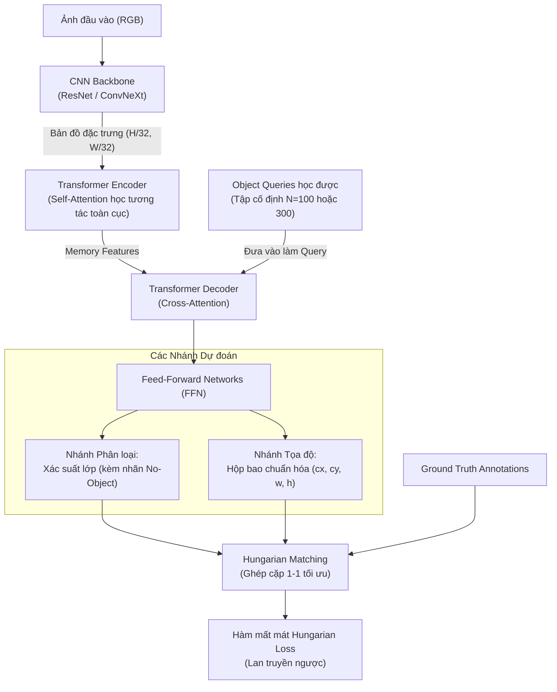

# Detection Transformer (DETR)

## 1. Định nghĩa & Bản chất (Definition & Core Idea)

- **Định nghĩa ngắn gọn:** **Detection Transformer (DETR)** là kiến trúc phát hiện vật thể tiên phong đưa toàn bộ mô hình Transformer vào thị giác máy tính, tái cấu trúc bài toán [[Object Detection]] thành bài toán **Dự đoán tập hợp trực tiếp (Direct Set Prediction)**, loại bỏ hoàn toàn các thành phần thủ công truyền thống như [[Anchor Box]] và thuật toán [[Non-Maximum Suppression (NMS)]].
- **Tác giả & Xuất xứ:** Nicolas Carion và các cộng sự tại Facebook AI Research (FAIR) công bố tại hội nghị ECCV 2020.
- **Tư duy đột phá:** Thay vì rải hàng trăm nghìn anchor boxes rồi dùng NMS để lọc trùng lặp, DETR sử dụng một tập cố định các vector học được gọi là **Object Queries** để truy vấn trực tiếp các vật thể trong ảnh và sử dụng thuật toán [[Hungarian Matching|Ghép cặp hai phía Hungarian (Hungarian Bipartite Matching)]] để gán đúng một dự đoán cho một nhãn thật.

---

## 2. Kiến trúc Tổng thể & 3 Trụ cột Kỹ thuật

![[Kiến trúc tổng thể DETR.png]]
### 1. Object Queries
- Là một ma trận tham số học được gồm $N$ vector nhúng ($N$ thường chọn là $100$ hoặc $300$).
- Mỗi Object Query đóng vai trò như một "truy vấn viên" độc lập: Nó đi vào Transformer Decoder, tương tác với toàn bộ bức ảnh thông qua cơ chế Cross-Attention để tìm xem có vật thể nào tương ứng với nó không.
- Sau khi huấn luyện, mỗi query tự động chuyên môn hóa vào các vùng không gian hoặc kích thước vật thể nhất định (ví dụ: query 1 hay tìm vật thể ở góc trái, query 2 hay tìm vật thể lớn ở trung tâm).

### 2. Hungarian Bipartite Matching (Ghép cặp 1-1)
Giả sử ảnh có $M$ vật thể thật ($M < N$). Ta bổ sung thêm $N - M$ nhãn rỗng $\varnothing$ (*No Object / Background*) để số lượng nhãn bằng đúng $N$ dự đoán.
Thuật toán Hungarian tìm kiếm một hoán vị $\hat{\sigma}$ trong tập hoán vị $\mathfrak{S}_N$ sao cho tổng chi phí ghép cặp $\mathcal{L}_{\text{match}}$ là nhỏ nhất:
$$\hat{\sigma} = \arg\min_{\sigma \in \mathfrak{S}_N} \sum_{i=1}^{N} \mathcal{L}_{\text{match}}(y_i, \hat{y}_{\sigma(i)})$$
Chi phí ghép cặp tính đồng thời cả sai số phân loại và sai số tọa độ:
$$\mathcal{L}_{\text{match}}(y_i, \hat{y}) = - \hat{p}(c_i) + \mathbb{I}_{\{c_i \neq \varnothing\}} \left[ \lambda_{\text{L1}} \|b_i - \hat{b}\|_1 + \lambda_{\text{giou}} \mathcal{L}_{\text{GIoU}}(b_i, \hat{b}) \right]$$
Nhờ việc ghép cặp 1-1 tối ưu, **mỗi vật thể chỉ được phụ trách bởi đúng một query duy nhất**, loại bỏ hoàn toàn hiện tượng trùng lặp box và không cần đến NMS.

### 3. Hàm mất mát Hungarian Loss
Sau khi đã tìm được cặp ghép tối ưu $\hat{\sigma}$, mô hình được tối ưu bằng hàm mất mát:
$$\mathcal{L}_{\text{DETR}}(y, \hat{y}) = \sum_{i=1}^{N} \left[ -\log \hat{p}_{\hat{\sigma}(i)}(c_i) + \mathbb{I}_{\{c_i \neq \varnothing\}} \left( \lambda_{\text{L1}} \|b_i - \hat{b}_{\hat{\sigma}(i)}\|_1 + \lambda_{\text{giou}} \mathcal{L}_{\text{GIoU}}(b_i, \hat{b}_{\hat{\sigma}(i)}) \right) \right]$$

---

## 3. Nhược điểm của DETR Gốc & Bước tiến Deformable DETR

### Hạn chế của DETR gốc
1. **Hội tụ cực kỳ chậm:** DETR cần tới 500 epochs trên tập dữ liệu COCO mới đạt độ chính xác tối ưu (trong khi Faster R-CNN chỉ cần 36-50 epochs). Nguyên nhân là cơ chế Self-Attention chuẩn phải tính trọng số trên toàn bộ các cặp pixel ($O(H^2 W^2)$), mất rất nhiều thời gian để học được cách tập trung vào vùng vật thể nhỏ.
2. **Kém hiệu quả với vật thể nhỏ:** Vì chi phí tính toán bậc hai của Attention quá nặng, DETR chỉ có thể tính trên feature map độ phân giải thấp (bị giảm $32$ lần), làm mất chi tiết của các vật thể nhỏ.

### Đột phá Deformable DETR (Zhu et al. - ICLR 2021)
- **Deformable Attention Module:** Thay vì để mỗi query tính attention với tất cả các vị trí trên ảnh, Deformable DETR chỉ cho mỗi query tập trung vào một số lượng nhỏ $K$ **điểm lấy mẫu then chốt (sampling offsets)** xung quanh một tọa độ tham chiếu (*Reference Point*).
- **Hỗ trợ Multi-scale Feature Maps:** Do độ phức tạp giảm từ $O(H^2 W^2)$ xuống tuyến tính, Deformable DETR dễ dàng tính toán trên các bản đồ đặc trưng đa tỷ lệ từ tầng nông đến tầng sâu (Feature Pyramid).
- **Kết quả:** Hội tụ nhanh gấp **10 lần** (chỉ cần 50 epochs) và vượt trội hoàn toàn DETR gốc ở khả năng phát hiện vật thể nhỏ.

---

## 4. Ứng dụng Thực chiến trong AutoCheckout-CL

Deformable DETR được lựa chọn làm kiến trúc nền tảng cho dự án [[06 - Projects/AutoCheckout/README|AutoCheckout-CL]] và bài báo PDP (CVPR 2026) vì 3 ưu điểm vượt trội trong bán lẻ:

1. **Khử trùng lặp tự nhiên:** Các sản phẩm trên khay thanh toán thường nằm sát nhau, chồng đè lên nhau. Deformable DETR loại bỏ NMS, tránh được lỗi "xóa nhầm sản phẩm thật đứng sát cạnh".
2. **Thích hợp cho Continual Learning:** Cấu trúc Object Queries và Attention cho phép áp dụng kỹ thuật **Prefix-Tuning (Prompting)** — đóng băng 100% Backbone và Transformer, chỉ học thêm các vector Prompt nhỏ để tiếp thu sản phẩm mới mà không bị quên sản phẩm cũ (*Catastrophic Forgetting*).
3. **Trích xuất Prototype chuẩn xác:** Đầu ra của các query ở tầng Decoder cuối cùng cung cấp các vector đặc trưng ngữ nghĩa rất giàu thông tin để xây dựng bảng nhớ **Class Prototype**.

---

## 5. Liên kết hệ thống & Nguồn (System Links & Sources)

- [[Object Detection]] — Bài toán nền tảng mà DETR tạo nên bước ngoặt kiến trúc.
- [[Hungarian Matching]] — Thuật toán giải bài toán phân công 1-1 tối ưu thay thế cho NMS.
- [[Bounding Box]] — Được hồi quy trực tiếp thông qua hàm mất mát L1 và GIoU.
- [[Anchor Box]] & [[Non-Maximum Suppression (NMS)]] — Các thành phần thủ công bị DETR loại bỏ hoàn toàn.
- [[Intersection over Union (IoU)]] — Thành phần cấu thành nên GIoU Loss trong Hungarian Matching.
- [[Mean Average Precision (mAP)]] — Thước đo đánh giá hiệu năng của DETR.
- [[06 - Projects/AutoCheckout/README|AutoCheckout-CL]] — Dự án ứng dụng Deformable DETR trong bài toán thanh toán tự động học tăng cường.
