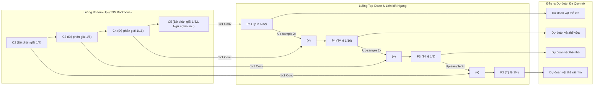

# Feature Pyramid Network (FPN - Mạng Kim tự tháp Đặc trưng)

## 1. Định nghĩa & Bản chất (Definition & Core Idea)

- **Định nghĩa ngắn gọn:** **Feature Pyramid Network (FPN)** là một kiến trúc trích xuất đặc trưng đa quy mô (*multi-scale feature extractor*) được giới thiệu bởi Tsung-Yi Lin et al. (2017), nhằm giải quyết bài toán phát hiện vật thể ở nhiều kích thước khác nhau (đặc biệt là vật thể rất nhỏ) với chi phí tính toán tăng thêm không đáng kể.
- **Vấn đề cốt lõi:**
  - Trong mạng tích chập tiêu chuẩn (CNN Backbone), các tầng nông (*shallow layers*) có độ phân giải không gian cao nhưng ngữ nghĩa yếu (chỉ chứa cạnh, góc).
  - Các tầng sâu (*deep layers*) có ngữ nghĩa phong phú nhưng độ phân giải không gian bị thu nhỏ mạnh do quá trình pooling/stride, khiến các vật thể nhỏ bị mất dấu hoàn toàn.
- **Giải pháp của FPN:** Kết hợp luồng xử lý từ dưới lên (*Bottom-up pathway*), luồng từ trên xuống (*Top-down pathway*) và các liên kết ngang (*Lateral connections*) để tạo ra một kim tự tháp đặc trưng mà tại **mọi tầng đều có độ phân giải không gian tốt và ngữ nghĩa mạnh mẽ**.

---

## 2. Cơ chế Hoạt động Chi tiết

1. **Bottom-up pathway:** Luồng truyền xuôi thông thường của CNN backbone (ví dụ ResNet), tạo ra các feature map $C_2, C_3, C_4, C_5$ với độ phân giải giảm dần theo tỷ lệ $1/4, 1/8, 1/16, 1/32$.
2. **Top-down pathway:** Phóng đại bản đồ đặc trưng tầng sâu bằng phép nội suy lân cận gần nhất (*Nearest Neighbor Up-sampling $2\times$*) để đưa về cùng kích thước không gian với tầng nông hơn.
3. **Lateral connections:** Dùng tích chập $1 \times 1$ trên $C_i$ để đồng bộ số kênh (thường là 256 kênh), sau đó cộng từng phần tử (*Element-wise Addition*) với bản đồ đã up-sample từ tầng trên.
4. **Smooth layer:** Chạy một lớp tích chập $3 \times 3$ trên mỗi bản đồ cộng để loại bỏ hiện tượng răng cưa do up-sampling gây ra, thu được các tầng kim tự tháp $P_2, P_3, P_4, P_5$.

---

## 3. Vai trò và Tác động đến các Thế hệ Detectors

- **Faster R-CNN với FPN:** RPN và Fast R-CNN Head được gắn trực tiếp vào tất cả các mức $P_2$ đến $P_5$. Các vật thể nhỏ tự động được gán cho tầng $P_2$ xử lý, vật thể lớn gán cho tầng $P_5$.
- **RetinaNet:** Kết hợp FPN với Focal Loss và One-Stage detection, đạt độ chính xác tương đương Faster R-CNN nhưng tốc độ cao hơn đáng kể.
- **Tiền thân của Multi-Scale Attention trong Transformer:** Ý tưởng kim tự tháp đặc trưng đa mức của FPN trực tiếp truyền cảm hứng cho cơ chế Multi-Scale Deformable Attention trong Deformable DETR.

---

## 4. Liên kết Hệ thống (System Links)

- [[Object Detection]] — Bài toán ứng dụng chính của FPN.
- [[Two-Stage Detectors]] — Tích hợp FPN vào Faster R-CNN / Mask R-CNN.
- [[One-Stage Detectors]] — Thành phần cốt lõi trong RetinaNet và các biến thể PANet của YOLO.
- [[Detection Transformer (DETR)]] — Cảm hứng cho cấu trúc đa tầng đặc trưng trong Deformable DETR.
- [[Anchor Box]] — Mỗi tầng của FPN thường được gắn một kích thước anchor box chuyên biệt.
