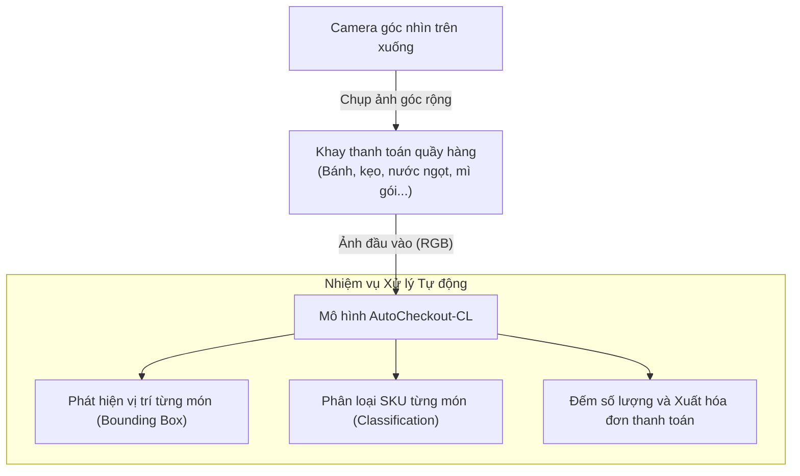

# Tổng quan Dự án AutoCheckout-CL & Phân tích Paper PDP (CVPR 2026)

Tài liệu này cung cấp bức tranh toàn cảnh về dự án **AutoCheckout-CL**, mục tiêu bài toán thực tế, và giải thích chi tiết bài báo khoa học **PDP (CVPR 2026)**. Tài liệu được biên soạn đặc biệt phù hợp cho người đã nắm vững các kiến thức Deep Learning cơ bản (theo chuẩn giáo trình [d2l.ai - Dive into Deep Learning](https://d2l.ai)), giúp làm rõ các khái niệm mới về _Continual Learning_, _Transformers trong Object Detection_, và _Prompt Tuning_.

---

## 1. Tổng quan dự án & Mục tiêu bài toán

### 1.1 Bối cảnh thực tế: Smart Retail Checkout

Hệ thống quầy thanh toán tự động bằng thị giác máy tính:

- Khách hàng đặt toàn bộ giỏ hàng lên quầy thanh toán.
- Camera góc nhìn từ trên xuống (top-down view) chụp một bức ảnh duy nhất chứa tất cả các sản phẩm trên khay.
- Hệ thống AI tự động xác định vị trí từng sản phẩm, phân loại chính xác mã sản phẩm (**SKU - Stock Keeping Unit**), đếm số lượng từng loại và in hóa đơn tính tiền mà không cần quét mã vạch thủ công.

![[smart-retail-checkout-tray-topdown.png]]
_(Placeholder minh họa: Cần tìm ảnh chụp thực tế góc nhìn từ trên xuống (top-down view) của một khay hàng quầy thanh toán tự động trong tập dữ liệu RPC hoặc siêu thị, chứa nhiều món hàng bán lẻ đặt đan xen để minh họa dữ liệu đầu vào thực tế)._

### 1.2 Bài toán cốt lõi: Học tăng cường không lưu dữ liệu cũ (Replay-Free Continual Learning)

Trong chuỗi bán lẻ, danh mục sản phẩm thay đổi liên tục: tuần này nhập thêm 25 loại nước ngọt mới, tháng sau nhập thêm 25 loại bánh mới.

- **Vấn đề của cách làm truyền thống:** Mỗi lần nhập sản phẩm mới, ta phải thu thập ảnh mới, gộp chung với toàn bộ ảnh của tất cả các sản phẩm cũ từ trước đến nay, rồi huấn luyện lại mô hình từ đầu (_Offline Retraining_). Cách này rất tốn tài nguyên GPU, thời gian huấn luyện kéo dài và vi phạm chính sách lưu trữ (không thể lưu mãi hàng trăm nghìn ảnh cũ).
- **Mục tiêu của AutoCheckout-CL:** Giải quyết bài toán **Class-Incremental Object Detection (IOD)**:
  1. **Học thêm sản phẩm mới tuần tự theo đợt (Task):** Mô hình tiếp thu các SKU mới mà không cần huấn luyện lại từ đầu.
  2. **Replay-free (Không lưu lại ảnh cũ):** Không được lưu trữ bất kỳ hình ảnh nào của các đợt nhập hàng trước. Chỉ được lưu trọng số mô hình và các vector đặc trưng rất nhỏ.
  3. **Chống quên thảm khốc (Mitigate Catastrophic Forgetting):** Khi học xong các sản phẩm mới, hệ thống vẫn nhận diện chính xác các sản phẩm cũ đã học từ các đợt trước.
  4. **Kịch bản thực nghiệm trên tập dữ liệu RPC (Retail Product Checkout):** 200 SKU, 30.000 ảnh quầy:
     - **Task 1 (Mở cửa hàng):** Học 100 SKU đầu tiên.
     - **Task 2 đến Task 5 (4 đợt nhập hàng tiếp theo):** Mỗi task học thêm 25 SKU mới.
     - **Kịch bản gán nhãn:** Ảnh chụp khay hàng ở Task mới có thể chứa lẫn lộn cả sản phẩm cũ và sản phẩm mới, nhưng **nhân viên chỉ gán nhãn cho các sản phẩm mới**. Mô hình phải tự nhận diện và khôi phục nhãn cho các sản phẩm cũ.

---

## 2. Cầu nối kiến thức: Từ d2l.ai đến Continual Object Detection

Nếu bạn đã học qua giáo trình **d2l.ai**, bạn đã nắm rất vững:

- _CNNs_ (ResNet, VGG, Batch Normalization), _Optimization_ (SGD, Adam, Backprop, Loss functions).
- _Object Detection cơ bản_: [[Anchor Box]], [[Bounding Box]] offsets, [[Intersection over Union (IoU)|IoU]], [[Non-Maximum Suppression (NMS)|NMS]], SSD.
- _Transformers_: Self-attention, Multi-head attention, Positional encoding, Transformer Encoder-Decoder.
- _Transfer Learning_: Freeze backbone, fine-tune linear classification head.

Dưới đây là bảng đối chiếu giúp bạn chuyển dịch từ kiến thức nền `d2l.ai` sang các khái niệm hiện đại trong Continual Learning và bài toán IOD:

| Khái niệm trong `d2l.ai`                        | Khái niệm mới trong Dự án & Paper PDP             | Bản chất sự khác biệt                                                                                                                                                       |
| ----------------------------------------------- | ------------------------------------------------- | --------------------------------------------------------------------------------------------------------------------------------------------------------------------------- |
| **Anchor boxes + NMS** (SSD, Faster R-CNN)      | **Query-based Detection & Deformable DETR**       | Thay vì rải hàng nghìn anchor boxes cố định rồi lọc NMS, dùng một tập **Object Queries** học được để truy vấn vật thể; dùng thuật toán **Hungarian Matching** ghép cặp 1-1. |
| **Fine-tuning toàn bộ** hoặc **Linear Probing** | **Prefix-Tuning (Parameter-Efficient Prompting)** | Đóng băng 100% Backbone và Transformer; chỉ chèn thêm các vector nhỏ gọi là **Prompt** vào trước ma trận Key và Value của các tầng Attention.                               |
| **Huấn luyện 1 lần (Static Training)**          | **Continual Learning (Học liên tục / Tăng dần)**  | Dữ liệu đến theo từng Task. Phải cân bằng giữa việc học cái mới (_Plasticity_) và giữ cái cũ (_Stability_).                                                                 |
| **Giám sát đầy đủ (Full Supervision)**          | **Inconsistent Supervision & Prompt Drift**       | Ảnh task mới có chứa vật thể lớp cũ nhưng không được gán nhãn. Nếu không xử lý, mô hình sẽ ngỡ vật cũ là Background và xóa sạch trí nhớ cũ.                                 |
| **Phân loại bằng Softmax Layer**                | **Class Prototype & Metric Learning**             | Biểu diễn mỗi lớp bằng một vector trung bình (**Prototype**) trong không gian embedding; so sánh khoảng cách/độ tương đồng Cosine.                                          |

---

### Chi tiết các khái niệm mới

#### 1. DETR & Deformable DETR (Detection Transformer)

- **Object Queries:** Trong DETR, ta khởi tạo một tập cố định các vector học được (ví dụ $N = 300$ queries). Các queries này đi vào Transformer Decoder, tương tác với đặc trưng của bức ảnh qua cơ chế Cross-Attention để tìm xem có vật thể nào tương ứng không. Mỗi query sẽ chịu trách nhiệm dự đoán 1 vật thể: tọa độ box $(cx, cy, w, h)$ và nhãn lớp.
- **Hungarian Matching (Bipartite Matching):** Trong SSD/YOLO, ta có hàng nghìn anchor boxes và phải dùng NMS để khử trùng lặp. DETR biến bài toán thành **ghép cặp 1-1 tối ưu**: Dùng thuật toán Hungarian tìm cách gán mỗi nhãn thật (Ground Truth) cho đúng một query dự đoán có chi phí sai lệch nhỏ nhất. Nhờ đó, DETR **hoàn toàn không cần NMS**.
- **Deformable Attention:** Trong Transformer chuẩn, mỗi điểm phải tính attention với mọi điểm ảnh khác ($O(H^2 W^2)$ tính toán rất nặng). Deformable DETR chỉ cho mỗi query tập trung vào một số lượng nhỏ điểm lấy mẫu xung quanh các vị trí tham chiếu quan trọng, giúp mô hình hội tụ nhanh hơn gấp 10 lần và giảm tải bộ nhớ GPU.

#### 2. Continual Learning & Quên thảm khốc (Catastrophic Forgetting)

- **Catastrophic Forgetting:** Khi mạng nơ-ron đang nhận diện tốt 100 loại hàng cũ (Task 1), nếu ta tiếp tục train nó trên dữ liệu chỉ gồm 25 loại hàng mới (Task 2), thuật toán Gradient Descent sẽ điều chỉnh toàn bộ trọng số để tối ưu cho 25 hàng mới, vô tình **ghi đè và phá hủy hoàn toàn** các đặc trưng nhận diện 100 hàng cũ.
- **Song đề Ổn định – Thích nghi (Stability–Plasticity Dilemma):**
  - _Plasticity (Tính thích nghi):_ Khả năng học nhanh, nhạy bén với lớp mới.
  - _Stability (Tính ổn định):_ Khả năng ghi nhớ vững chắc các lớp cũ.
- **Replay-free vs. Exemplar Replay:**
  - _Exemplar Replay:_ Lưu lại một vài ảnh cũ (ví dụ 5–10 ảnh/lớp) để train kèm khi học lớp mới.
  - _Replay-free:_ **Không lưu bất kỳ ảnh cũ nào** (vì lý do bảo mật, dung lượng hoặc bản quyền). Đây là bài toán khó nhất và là trọng tâm của dự án này.

#### 3. Prefix-Tuning (Prompting trong Vision Transformer)

Thay vì cập nhật trọng số khổng lồ của mô hình (hàng chục triệu tham số):

- Ta đóng băng (Freeze) hoàn toàn Backbone, Transformer Encoder và Decoder.
- Ta chỉ tạo thêm một số ít vector tham số học được gọi là **Prompt Tokens** ($P$).
- Khi tính Multi-Head Attention, ta ghép các Prompt này vào trước ma trận Key ($K$) và Value ($V$):
  $$K_{\text{new}} = [P_K; K], \quad V_{\text{new}} = [P_V; V]$$
- Mô hình chỉ học các vector Prompt này (chỉ vài chục nghìn tham số, cực kỳ nhẹ), qua đó điều chỉnh cách Decoder đọc hiểu đặc trưng mà không làm thay đổi các tầng đã học.

#### 4. Inconsistent Supervision (Giám sát bất nhất) & Prompt Drift

Trong bài toán Object Detection tăng cường:

- Ở Task 2, khách hàng đặt lên khay cả chai Coca (đã học ở Task 1) và lon trà sữa (món mới của Task 2).
- Nhân viên thu ngân chỉ gán nhãn cho lon trà sữa mới. Vùng ảnh chứa chai Coca **không có nhãn**.
- Trong Object Detection thông thường, vùng nào không có nhãn thì hàm mất mát coi đó là **Nền (Background)**!
- **Hậu quả:** Gradients phạt mô hình nếu nó nhận ra chai Coca $\rightarrow$ Các vector Prompt đang học bị kéo lệch dần về ngữ nghĩa sai lệch $\rightarrow$ Hiện tượng này gọi là **Prompt Drift (Trôi dạt Prompt)**.

#### 5. Class Prototype (Nguyên mẫu lớp)

- **Prototype của lớp $c$ ($p_c$):** Là vector trung bình (Centroid) biểu diễn cho toàn bộ các mẫu thuộc lớp $c$ trong không gian đặc trưng (Feature Space).
- Được tính bằng cách lấy trung bình cộng các vector đặc trưng query ở tầng cuối của mô hình đối với các dự đoán đúng của lớp $c$:
  $$p_c = \frac{1}{|F_c|} \sum_{f_i \in F_c} f_i$$
- Prototype này được lưu vào một bảng nhớ nhỏ (chỉ vài trăm con số thực cho mỗi lớp, chiếm vài KB) và không bao giờ bị quên.

---

## 3. Phân tích & Giải thích Paper PDP (CVPR 2026)

- **Tên bài báo:** _Beyond Prompt Degradation: Prototype-guided Dual-pool Prompting for Incremental Object Detection_
- **Tác giả:** Yaoteng Zhang, Qing Zhou, Junyu Gao, Qi Wang (CVPR 2026).
- **Mã nguồn gốc:** [github.com/zyt95579/PDP_IOD](https://github.com/zyt95579/PDP_IOD)

![[The overall architecture of the PDP framework.png]]

_Decoupled Dual-Pool Prompting (DDP) module for knowledge separation and a Prototypical Pseudo-Label Generation (PPG) module to provide consistent supervision for old classes_

### 3.1 Hai căn bệnh paper chỉ ra: "Prompt Degradation"

Các nghiên cứu trước (như MD-DETR) dùng một bể prompt duy nhất (Single Prompt Pool) gặp phải sự suy thoái prompt do:

1. **Prompt Coupling (Trộn lẫn / Giẫm chân nhau):** Gom cả tri thức dùng chung (cạnh, góc, ngữ cảnh chung) và tri thức phân biệt riêng từng lớp (lon Coca khác lon Pepsi) vào cùng 1 kho. Chúng cạnh tranh không gian tham số và triệt tiêu lẫn nhau.
2. **Prompt Drift (Trôi dạt Prompt):** Do vật thể lớp cũ không có nhãn bị xem là Background, ép prompt trôi dần theo hướng tiêu cực. Các phương pháp sinh nhãn giả trước đây chỉ dùng 1 ngưỡng cố định (Static threshold, ví dụ điểm tin cậy $> 0.5$) thường thất bại vì các lớp có phân bố điểm rất khác nhau; nhiều vật thể cũ điểm $0.3 - 0.4$ bị vứt bỏ oan uổng.
   ![[pdp-prompt-drift-feature-space-illustration.png]]
   _(Placeholder minh họa: Cần tìm hình biểu diễn không gian đặc trưng hoặc biểu đồ t-SNE từ bài báo PDP CVPR 2026 minh họa sự suy thoái của Prompt khi bị trôi dạt về phía Background so với khi được giữ ổn định bằng Prototype)._

---

### 3.2 Giải pháp 1: Decoupled Dual-Pool Prompting (DDP - Tách biệt hai kho Prompt)

PDP đề xuất chia prompt thành hai kho hoàn toàn độc lập:

1. **Kho dùng chung (Shared Pool - $P_s$):**
   - Chứa $N_s$ prompts (ví dụ 100 vector), liên tục được cập nhật qua tất cả các task.
   - Chức năng: Lưu giữ các đặc trưng thị giác khái quát, giúp chuyển giao tri thức tích cực cho các task tương lai (_forward transfer_).
2. **Kho riêng (Private Pool - $P_p$):**
   - Mỗi task mới đưa vào số prompt tương ứng với số lớp mới (ví dụ 25 SKU $\rightarrow$ 25 prompts).
   - Chỉ được huấn luyện trong task của nó. **Sau khi task kết thúc, toàn bộ prompt của task này bị đóng băng (freeze) vĩnh viễn.**
   - Chức năng: Giữ nguyên vẹn đặc trưng phân biệt của từng lớp, chống quên thảm khốc (_stability_).
3. **Truy xuất Prompt tự động (Task-agnostic Retrieval):**
   - Khi suy luận trên ảnh mới, mô hình không cần biết ảnh này thuộc task nào.
   - Trích xuất query vector $Q$ từ ảnh, tính độ tương đồng Cosine giữa $Q$ với các Key ($K_s, K_p$) của cả 2 kho để lấy trọng số $w$, rồi cộng trọng số thành vector prompt đại diện $P_r$:
     $$P_r = \sum_{i=1}^{N_s} w_{s,i} P_{s,i} + \sum_{j=1}^{N_p} w_{p,j} P_{p,j}$$
   - $P_r$ được chia làm $P_K$ và $P_V$ đưa vào làm Prefix cho Multi-Head Attention của Decoder.
4. **Hàm mất mát trực giao $L_{DDL}$ (Directional Decoupled Loss):**
   - Ép góc giữa các vector của Kho chung và Kho riêng phải lớn hơn hoặc bằng $90^\circ$ (trực giao):
     $$L_{DDL} = \lambda_{ddl} \cdot \frac{1}{|N_s||N_p|} \sum_{i=1}^{|N_s|} \sum_{j=1}^{|N_p|} \max(0, 90^\circ - \theta_{i,j})^2$$
   - Giúp hai kho học hai không gian biểu diễn bổ trợ nhau, không bị trùng lặp.

---

### 3.3 Giải pháp 2: Prototypical Pseudo-Label Generation (PPG - Sinh nhãn giả bằng nguyên mẫu)

Khi đang huấn luyện ở Task $t$, mô hình giáo viên $\Phi_{t-1}$ (mô hình đã học xong ở task trước và được đóng băng) sẽ rà soát ảnh để gán nhãn giả cho các vật thể lớp cũ:

- **Bộ nhớ Prototype:** Ở epoch cuối cùng của mỗi task, mô hình trích xuất đặc trưng của các vật thể đoán đúng để tính vector trung bình (Prototype $p_c$) cho từng lớp và lưu lại.
- **Xác thực 2 tầng (Hierarchical Validation):**
  - **Tầng 1 (Easy Samples - Tự tin cao):** Dự đoán của teacher có điểm tin cậy $s_i > \tau_h$ (ví dụ $> 0.5$) $\rightarrow$ Nhận ngay làm nhãn giả tin cậy.
  - **Tầng 2 (Potential Hard Samples - Điểm lưng chừng):** Dự đoán có điểm $\tau_l < s_i \le \tau_h$ (ví dụ từ $0.2$ đến $0.5$). Thay vì vứt bỏ như các phương pháp cũ, PPG trích xuất đặc trưng query của box này và tính độ tương đồng Cosine với **Prototype $p_c$** của lớp tương ứng:
    $$\text{Cosine Sim}(f_i, p_c) \ge \tau_s \quad (\text{ngưỡng } 0.5) \implies \text{Giữ lại làm nhãn giả!}$$
- Nhờ có Prototype bảo chứng, những vật thể bị che khuất hoặc góc chụp khó (điểm confidence thấp) vẫn được cứu lại, không bị coi là Background, dập tắt hoàn toàn hiện tượng Prompt Drift.

---

### 3.4 Bộ chỉ số đánh giá chuẩn trong Continual Learning

Trong Continual Learning, ta không chỉ nhìn vào 1 con số Accuracy duy nhất mà đo 3 chỉ số sau mỗi Task:

- **$mAP@P$ (Previous Classes):** Đo trên các lớp cũ đã học ở các task trước. Đánh giá khả năng **giữ vững kiến thức cũ (Stability)**.
- **$mAP@C$ (Current Classes):** Đo trên các lớp mới của task hiện tại. Đánh giá khả năng **học kiến thức mới (Plasticity)**.
- **$mAP@A$ (All Classes):** Đo trung bình trên tất cả các lớp đã thấy từ trước đến nay. Đánh giá **hiệu năng tổng thể**.

---

## 4. Áp dụng PDP vào bài toán thực tế AutoCheckout-CL

Dù paper PDP đạt kết quả rất ấn tượng trên MS-COCO và Pascal VOC, khi đưa vào bài toán quầy thanh toán tự động với tập dữ liệu **RPC (Retail Product Checkout)**, dự án AutoCheckout-CL đã chỉ ra và xử lý 3 khoảng cách lớn:

### 4.1 Thách thức 1: Phân loại siêu chi tiết (Fine-grained) & First Session Adaptation (FSA)

- **Trong paper:** Thử nghiệm trên COCO/VOC là các lớp cách xa nhau (chó, mèo, ô tô, máy bay). Mô hình Deformable DETR pretrained trên 80 lớp COCO đã có sẵn đặc trưng rất tốt.
- **Trong thực tế RPC:** 200 SKU là hàng tiêu dùng: hai lon nước ngọt cùng kích cỡ, cùng màu nền, chỉ khác dòng chữ "ít đường" vs "nguyên bản". Nếu đóng băng toàn bộ backbone COCO ngay từ Task 1, mô hình sẽ không đủ sức phân biệt các đặc trưng siêu chi tiết này.
- **Giải pháp của dự án:** Thực hiện bước **First Session Adaptation (FSA)** — Huấn luyện toàn bộ mô hình trên dữ liệu Task 1 trước để backbone học được không gian đặc trưng bán lẻ, sau đó mới đóng băng và bắt đầu áp dụng cơ chế PDP từ Task 2.

![[rpc-fine-grained-skus-comparison.png]]
_(Placeholder minh họa: Cần tìm ảnh so sánh các sản phẩm bao bì siêu chi tiết trong tập dữ liệu RPC, ví dụ hai sản phẩm cùng nhãn hiệu, cùng kích thước chai/hộp nhưng khác dòng sản phẩm/hương vị để làm rõ thách thức phân loại fine-grained)._

### 4.2 Thách thức 2: Từ mAP đến Checkout Accuracy (cAcc - Độ chính xác hóa đơn)

- Trong bài toán phát hiện vật thể học thuật, mAP@50 cao là đủ.
- Nhưng trong quầy thanh toán siêu thị: **Khách đặt 10 món hàng, nếu đếm sót 1 món hoặc nhận nhầm 1 món thì hóa đơn tính tiền bị sai hoàn toàn!**
- Do đó, dự án bổ sung bộ chỉ số đánh giá chuyên dụng của bán lẻ:
  - **cAcc (Checkout Accuracy):** Tỷ lệ các khay hàng mà số lượng của mọi SKU đều được đếm chính xác 100%.
  - **ACD (Average Counting Distance):** Số lượng sản phẩm bị đếm lệch trung bình trên mỗi khay.

### 4.3 Thách thức 3: Hoàn thiện mã nguồn gốc (12 bản vá kỹ thuật F1–F12)

Khi phân tích mã nguồn gốc của tác giả bài báo (`zyt95579/PDP_IOD`), nhóm phát hiện nhiều lỗi logic nghiêm trọng và đã viết 12 bản sửa lỗi (F1–F12) trong thư mục `pdp/`:

- **Hard-code 80 lớp COCO:** Code gốc mặc định số lớp tối đa là 80; khi đưa 200 lớp của RPC vào, các task sau bị nhận 0 prompt riêng mà không báo lỗi $\rightarrow$ Sửa thành cấp phát linh động theo số lượng SKU.
- **Tắt nhầm loss $L_{DDL}$:** Code gốc đặt `use_ddl_loss = False` khiến hai kho prompt không bị ép trực giao như paper viết $\rightarrow$ Đã bật và tích hợp lại đúng lý thuyết.
- **Teacher chạy thiếu prompt:** Code gốc khi gọi teacher $\Phi_{t-1}$ lại không truyền query prompt, khiến teacher yếu hơn nhiều so với năng lực thực tế $\rightarrow$ Bổ sung cơ chế forward 2 lượt cho teacher.
- **Lệch chỉ số lọc nhãn:** Sửa toán tử so sánh nhãn giả để lớp mới đầu tiên không bị gán nhầm nhãn từ teacher.

---

## 5. Tài liệu Chuyên sâu trong Hệ sinh thái Dự án

Để tiếp tục đi sâu vào mã nguồn và triển khai, bạn có thể tham khảo các tài liệu chuyên biệt đã được chuẩn hóa trong thư mục dự án:

| Tài liệu                                             | Nội dung chi tiết                                                                                                          |
| ---------------------------------------------------- | -------------------------------------------------------------------------------------------------------------------------- |
| [[Codebase README]]                                  | Cấu trúc tổng thể của kho mã nguồn tại `/home/sakana/Code/AutoCheckout-CL`, hướng dẫn cài đặt môi trường và chạy unit test |
| [[Phân tích PDP cho đồ án thanh toán tự động (RPC)]] | Báo cáo phân tích chuyên sâu tính tương thích của PDP trên tập dữ liệu RPC, rủi ro và các giải pháp kỹ thuật               |
| [[GCP Training Guide]]                               | Hướng dẫn vận hành máy ảo GPU (NVIDIA L4) trên Google Cloud, quản lý dữ liệu và cấu hình Spot VM tiết kiệm chi phí         |
| [[Giải thích Paper PDP]]                             | Cẩm nang giải thích chi tiết bài báo khoa học PDP với đầy đủ 13 công thức toán học và đối chiếu mã nguồn                   |
| [[formats]]                                          | Quy ước định dạng file annotations COCO JSON, cấu trúc thư mục dữ liệu `$DATA` và file lưu dự đoán `.npz`                  |
