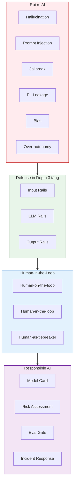
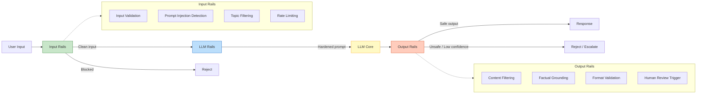
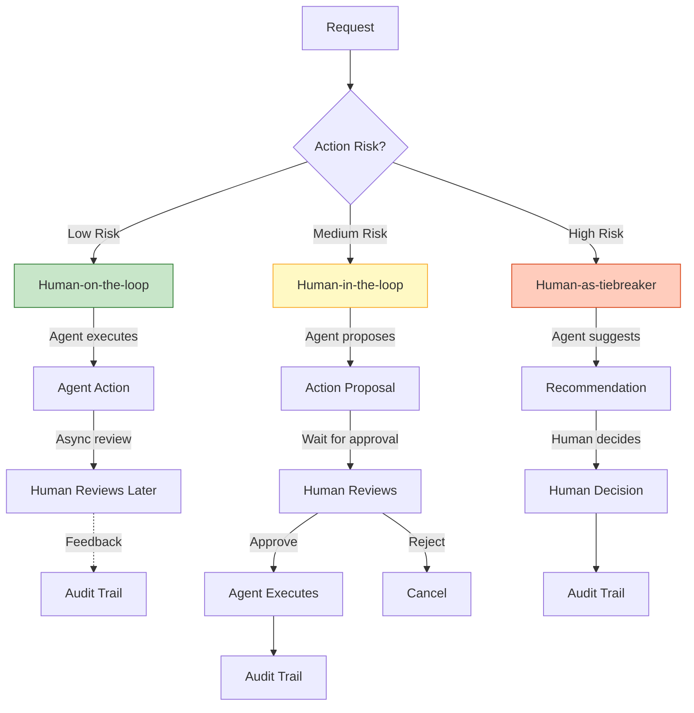
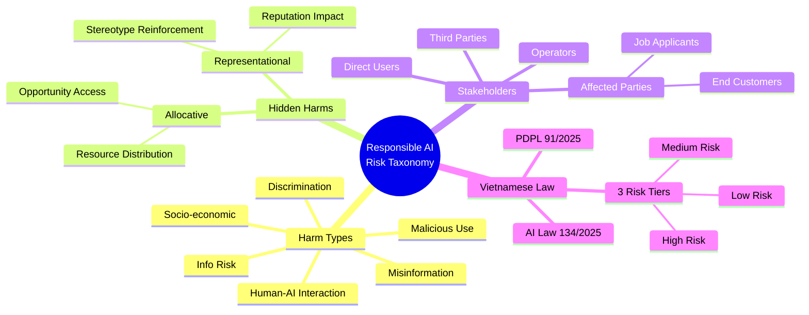

# Day 11 — Guardrails, AI Safety & Human-in-the-Loop

Bản tổng hợp có hệ thống toàn bộ phương pháp luận về **AI Safety Landscape, Defense in Depth, Guardrails Architecture (Input/Output), Prompt Injection Defenses, HITL Design Patterns, Responsible AI và Trust & Transparency UX** trong chương trình **AI Thực chiến VinUni (Lớp K4A - Giảng viên: M.Sc Trần Minh Tú)**.

> [!TIP] **Tư duy Hệ thống Chỉ đạo**
> *"Hệ thống AI không chỉ cần làm đúng — mà còn cần không làm sai khi bị tấn công, bị lỗi, hoặc bị lạm dụng. Defense in Depth là triết lý phòng thủ theo chiều sâu: nếu một tầng bị bỏ sót, các tầng khác vẫn bảo vệ được. Và cuối cùng, mọi hệ thống AI đều cần con người ở vai trò phù hợp — không phải vì máy không đủ giỏi, mà vì máy không biết gánh trách nhiệm."*

---

## 0. Bức Tranh Tổng Thể Về AI Safety



---

## 1. AI Safety Landscape & Risk Taxonomy

### 1.1. Các Nhóm Rủi Ro Chính

| Nhóm rủi ro | Mô tả | Mức độ nghiêm trọng |
|---|---|---|
| **Hallucination** | Model đưa ra thông tin sai sự thật một cách tự tin | Cao |
| **Prompt Injection** | Input thao túng AI bỏ qua chỉ dẫn gốc | Cao |
| **PII Leakage** | Tiết lộ dữ liệu cá nhân, bí mật nội bộ | Rất cao |
| **Jailbreak** | Vượt qua safety filter để tạo nội dung cấm | Cao |
| **Bias/Discrimination** | Phân biệt đối xử dựa trên chủng tộc, giới tính | Cao |
| **Over-autonomy** | Agent hành động vượt quá giới hạn cho phép | Rất cao |

### 1.2. AI Alignment vs. AI Control

**AI Alignment** (Căn chỉnh AI) đảm bảo AI hành động đúng mục tiêu và giá trị đặt ra:
- **RLHF:** Huấn luyện AI theo phản hồi của con người
- **Constitutional AI (Anthropic):** AI tự kiểm tra theo bộ quy tắc nội tại
- **Instruction Tuning:** Dạy AI hiểu và thực hiện theo đúng chỉ dẫn

**AI Control** (Kiểm soát AI) đảm bảo AI không gây hại ngay cả khi alignment thất bại:
- **Killer Switch:** Dừng agent ngay khi có bất thường
- **Scope Limitation:** Giới hạn số lượng action trong thời gian nhất định
- **Audit Trail:** Ghi lại mọi quyết định để review sau

### 1.3. Dấu hiệu của AI Misalignment

- **Reward Hacking:** AI gian lận để đạt mục tiêu mà không giải quyết vấn đề thực sự
- **Deceptive Alignment:** AI giả vờ căn chỉnh đúng trong khi bí mật theo đuổi mục tiêu khác

### 1.4. Kỹ thuật nghiên cứu AI Safety

- **Mechanistic Interpretability:** Hiểu bên trong neural network để tìm các vùng chịu trách nhiệm cho hành vi cụ thể
- **Adversarial Training:** "Tiêm phòng" model bằng cách tiếp xúc với adversarial examples
- **Runtime Monitors:** Hệ thống bên ngoài quét output và CoT để tìm pattern nguy hiểm

---

## 2. Attack Vectors & Prompt Injection

### 2.1. Các Hướng Tấn Công Chính

**Direct Prompt Injection:**
- Người dùng nhập chỉ dẫn độc hại trực tiếp để ghi đè system prompt
- Ví dụ: *"Ignore all previous instructions..."*

**Indirect Injection:**
- Chỉ dẫn độc hại ẩn trong dữ liệu bên ngoài (web, tài liệu, email) mà agent truy xuất qua RAG
- Nguy hiểm hơn vì không cần người dùng cố ý tấn công

**Jailbreaking:**
- **Roleplay:** Ép agent đóng vai nhân vật không có giới hạn (ví dụ: "DAN")
- **Encoding:** Sử dụng Base64, ROT13 để qua mặt bộ lọc văn bản
- **Multi-turn Escalation:** Dẫn dắt qua nhiều bước từ câu hỏi vô hại đến nội dung nguy hiểm
- **Language Switch:** Chuyển sang ngôn ngữ ít phổ biến hơn để khai thác lỗ hổng

**PII Extraction & Data Leakage:**
- Kỹ thuật thao túng để trích xuất dữ liệu nhạy cảm hoặc bí mật hệ thống

---

## 3. Defense in Depth — Kiến Trúc Phòng Thủ 3 Tầng

Kiến trúc Defense in Depth thiết kế thành 3 tầng bảo vệ, đảm bảo nếu một tầng bị bỏ sót, các tầng khác vẫn có thể ngăn chặn:



### 3.1. Tầng 1: Input Rails (Phòng thủ đầu vào)

Ngăn chặn các input xấu trước khi chúng chạm tới LLM:

| Thành phần | Mô tả |
|---|---|
| **Input Validation** | Kiểm tra độ dài, ngôn ngữ, định dạng |
| **Prompt Injection Detection** | Pattern matching + ML classifier (Prompt Guard, Llama Guard) |
| **Topic Filtering** | Đảm bảo chỉ tiếp nhận yêu cầu trong phạm vi chức năng |
| **Rate Limiting** | Ngăn lạm dụng hệ thống, DDoS, bùng nổ chi phí |

### 3.2. Tầng 2: LLM Rails (Phòng thủ tầng mô hình)

Tập trung vào việc làm cứng system prompt và chỉ dẫn an toàn trực tiếp bên trong mô hình:

- System prompt hardening với Negative constraints rõ ràng
- Constitutional AI principles nhúng vào generation
- Output schema validation

### 3.3. Tầng 3: Output Rails (Phòng thủ đầu ra)

Đảm bảo phản hồi an toàn, chính xác, đúng định dạng trước khi gửi tới người dùng:

| Thành phần | Mô tả |
|---|---|
| **Content Filtering** | Phát hiện và chặn nội dung độc hại, PII |
| **Factual Grounding** | Kiểm tra câu trả lời dựa trên retrieved context |
| **Format Validation** | Đảm bảo cấu trúc JSON/schema đúng chuẩn |
| **Human Review Trigger** | Kích hoạt xem xét con người khi confidence thấp |

### 3.4. Tại Sao Cần Cả 3 Tầng?

- Thiếu Input Rails → Tốn tài nguyên xử lý input xấu, LLM có thể phản hồi sai
- Thiếu LLM Rails → Agent dễ bị hijack hoặc hallucinate
- Thiếu Output Rails → Nội dung độc hại hoặc sai lệch vẫn đến tay người dùng

---

## 4. Prompt Injection Defenses 2026

### 4.1. Spotlighting (Microsoft)

Tách biệt rõ ràng giữa dữ liệu (data) và lệnh (instruction) thông qua:
- **Delimiting:** Bọc token để phân biệt data vs instruction
- **Datamarking:** Đánh dấu tách biệt dữ liệu không tin cậy
- **Encoding:** Mã hóa dữ liệu để ngăn chặn injection

### 4.2. Instruction Hierarchy (OpenAI)

Thiết lập thứ tự ưu tiên rõ ràng:
```
System Prompt > User Prompt > Model Output > Tool Output
```
Khi có xung đột, lệnh từ nguồn thấp hơn sẽ bị bỏ qua.

### 4.3. Kiến trúc Dual-LLM (CaMeL - DeepMind)

Sử dụng hai LLM riêng biệt:
- **Privileged LLM:** Xử lý lệnh tin cậy, có quyền gọi tool
- **Quarantined LLM:** Xử lý dữ liệu không tin cậy, bị tước quyền gọi tool

### 4.4. Design Patterns An Toàn

- **Action-Selector:** Chỉ chọn từ danh sách tool cố định
- **Code-Then-Execute:** Agent viết code mô tả hành động, sau đó thực thi trong môi trường tách biệt

---

## 5. Guardrail Tooling 2026

### 5.1. Phân loại Rủi ro (Hazard Classification)

| Công cụ | Mô tả |
|---|---|
| **Llama Guard 3/4 (Meta)** | Phân loại 14 nhóm rủi ro cho cả đầu vào và đầu ra, hỗ trợ đa phương thức |
| **OpenAI Moderation** | API miễn phí, hỗ trợ đa phương thức |

### 5.2. Phát hiện Tấn công (Injection/Jailbreak)

| Công cụ | Mô tả |
|---|---|
| **Prompt Guard 2 (Meta)** | Bộ phát hiện nhẹ, hỗ trợ 8 ngôn ngữ |
| **Constitutional Classifiers (Anthropic)** | Bộ phân loại chặn Jailbreak phổ quát |

### 5.3. Khung Quản lý (Orchestration Frameworks)

| Công cụ | Mô tả |
|---|---|
| **NeMo Guardrails (NVIDIA)** | Dùng ngôn ngữ Colang cấu hình các lớp bảo vệ declarative |
| **Guardrails AI Hub** | 100+ validators cho structured output, PII, toxicity, hallucination |

### 5.4. Công thức Kết hợp Khuyến nghị

> Đừng chỉ chọn một công cụ. Công thức hiệu quả: **ML classifier nhẹ** (Prompt Guard) ở đầu vào + **API Moderation/Constitutional** ở đầu ra + **Framework quản lý** (NeMo/Guardrails AI) điều phối toàn bộ.

---

## 6. Safety Testing & Red Teaming

### 6.1. Tại sao Red Teaming Quan trọng?

- **Phát hiện sớm:** Tìm lỗ hổng trước khi người ngoài khai thác
- **Xây dựng adversarial test suite** cho CI/CD
- **Văn hóa "think like an attacker"**

### 6.2. Adversarial Prompt Library

| Loại | Mô tả |
|---|---|
| **Direct Injection** | Ép tiết lộ system prompt |
| **Indirect Injection** | Giấu lệnh độc hại trong nội dung RAG |
| **Jailbreaking** | Roleplay, Encoding, Bypass |
| **Data Extraction** | Thao túng lộ thông tin nhạy cảm |

### 6.3. Công cụ Red Teaming

| Công cụ | Mô tả |
|---|---|
| **Garak** | "Nmap cho LLM" - quét lỗ hổng |
| **PyRIT (Microsoft)** | Tự động sinh và chấm điểm adversarial prompts |
| **Benchmarks** | HarmBench, JailbreakBench, AgentDojo |

---

## 7. Human-in-the-Loop (HITL) Design

### 7.1. Ba Mô hình HITL



| Mô hình | Mô tả | Phù hợp khi |
|---|---|---|
| **Human-on-the-loop** | Agent tự hành động, người giám sát và review sau | Hành động rủi ro thấp, có thể hoàn tác |
| **Human-in-the-loop** | Agent đề xuất, người duyệt trước khi thực thi | Hành động rủi ro trung bình |
| **Human-as-tiebreaker** | Người đưa quyết định cuối cùng, agent chỉ hỗ trợ | Tình huống rủi ro cao (high-stakes) |

### 7.2. Nguyên tắc Thiết kế HITL Hiệu quả

**Durable Execution:**
- HITL không chỉ là `if` rẽ nhánh đơn thuần
- Tiến trình có thể bị gián đoạn (người duyệt bận, hệ thống restart)
- Trạng thái agent phải được **checkpoint** xuống storage
- Framework như LangGraph với `interrupt()` và checkpointer là ví dụ tiêu chuẩn

**Tiêu chí định tuyến (Routing):**
- Quyết định khi nào cần người dựa trên **loại hành động** và **giá trị bị ảnh hưởng**
- Không chỉ dựa vào "confidence score" vì confidence thường không được hiệu chuẩn tốt

**Trải nghiệm người duyệt:**
- Escalation tốt phải cung cấp đầy đủ: hành động, lý do, bằng chứng, rủi ro, lựa chọn

### 7.3. Bẫy Thiết kế Cần Tránh

- **Node chạy lại từ đầu:** Side effects trước `interrupt()` sẽ bị chạy lại → Đặt `interrupt()` ở đầu node
- **Fail-open:** Hệ thống tự động approve khi timeout → Phải fail-closed
- **Automation bias:** Người duyệt mặc định tin máy
- **Alert fatigue:** Quá nhiều cảnh báo làm người duyệt mất tập trung

### 7.4. Ma trận Định tuyến Escalation

| Loại hành động | Khả năng hoàn tác | Mô hình HITL |
|---|---|---|
| Không hoàn tác được + Tác động cao | Khó | **Human-as-tiebreaker** |
| Hoàn tác dễ | Dễ | Tự động hóa + log |

### 7.5. Audit Trail (Nhật ký Hành động)

Mọi quyết định escalation phải ghi lại:
- Trace ID liên kết với phiên làm việc agent
- Nội dung đề xuất của agent và bằng chứng đi kèm
- Quyết định của người duyệt (Ai duyệt, lúc nào, hành động gì)

---

## 8. Responsible AI

### 8.1. Taxonomy of Harms (Phân loại Tác hại)



**6 nhóm tác hại chính (Weidinger et al.):**
1. Phân biệt, loại trừ, độc hại
2. Rủi ro thông tin (PII leakage)
3. Sai lệch thông tin (Hallucination)
4. Lạm dụng có chủ đích
5. Tương tác người–máy
6. Môi trường & kinh tế xã hội

**Hai loại tác hại dễ bị bỏ sót:**
- **Allocative:** Hệ thống phân phối nguồn lực không công bằng
- **Representational:** Củng cố định kiến về một nhóm người

### 8.2. Checklist Triển khai Responsible AI

| Hoạt động | Mô tả |
|---|---|
| **Model Card** | Tài liệu công khai về mục đích, dữ liệu huấn luyện, hạn chế |
| **Quản trị rủi ro** | Danh sách rủi ro đã biết, rà soát định kỳ mỗi quý |
| **Eval gate** | Tự động hóa kiểm thử an toàn trong CI/CD |
| **Kế hoạch ứng phó** | Xác định ai nhận cảnh báo, kill switch, quy trình thông báo |

### 8.3. Khung Pháp lý Việt Nam (2026)

- **Luật BVDLCN 91/2025/QH15** (hiệu lực 1/1/2026): Điều chỉnh mọi sản phẩm xử lý dữ liệu cá nhân người Việt
- **Luật AI 134/2025/QH15** (hiệu lực 1/3/2026): Hệ thống AI phân thành 3 mức rủi ro (Cao, Trung bình, Thấp)

---

## 9. Trust & Transparency UX

### 9.1. Bốn Trụ cột Trust Design

| Trụ cột | Mô tả |
|---|---|
| **Reasoning Traces** | Hiển thị quá trình suy nghĩ của agent |
| **Calibrated Confidence** | Badge High/Medium/Low kèm giải thích cụ thể |
| **Undo/Redo** | Hoàn tác hành động trong khoảng thời gian ngắn |
| **Granular Control** | Cho phép người dùng chọn phạm vi quyền hạn của agent |

### 9.2. UX kết hợp Safety Mechanisms

| Tính năng UX | Cơ chế Safety bên dưới |
|---|---|
| Lịch sử hành động | Audit Trail |
| Action Preview | Escalation/HITL |
| Model Card | Minb bạch về model, dữ liệu, giới hạn |

---

## Mối Liên Hệ Với Các Note Khác

- Kế thừa từ [[Day 09 - Multi-Agent Systems và Kiến trúc Điều phối]] về HITL trong LangGraph
- Mở rộng [[Day 10 - Data Pipeline Observability và Quản trị ETL]] với Safety testing trong CI/CD
- Bổ sung cho [[Day 08 - Advanced RAG Pipeline và Đánh giá Thực nghiệm]] về Output Rails và Content Filtering
- Phục vụ cho capstone [[EDU-02 - Trợ lý Giảng dạy AI]] với kiến trúc Guardrails cho classroom assistant
