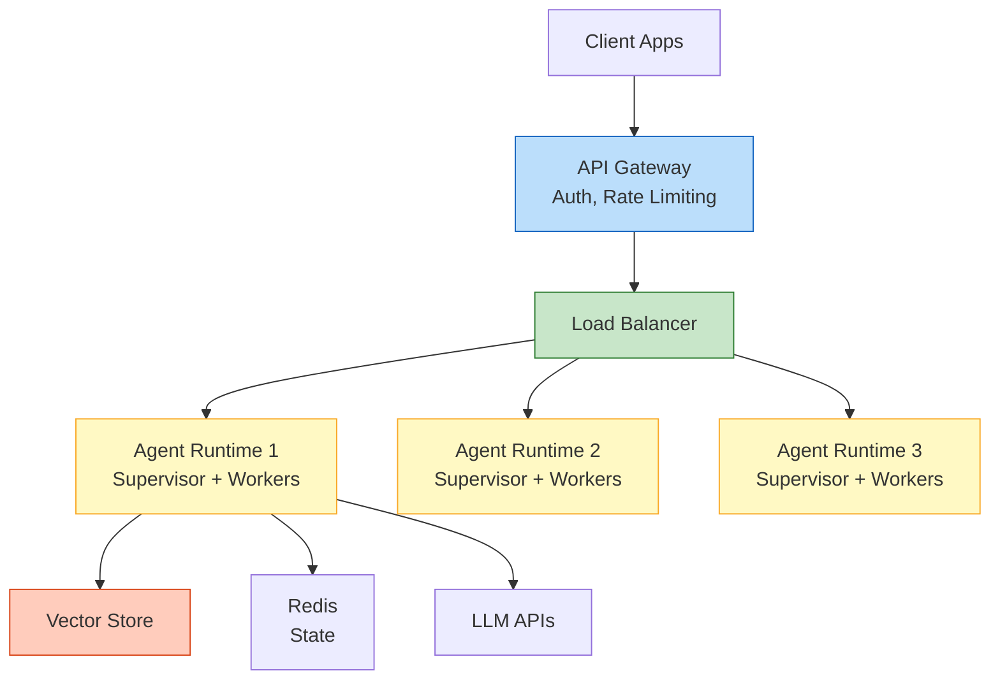
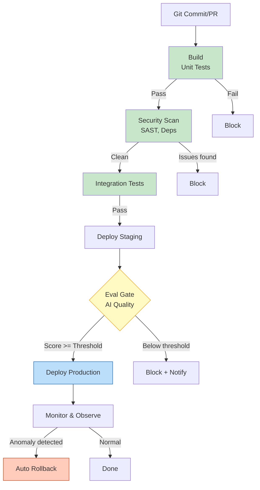

# Day 12 — Deployment, Cloud & Agent Hosting

Bản tổng hợp có hệ thống toàn bộ phương pháp luận về **Local-to-Production Pipeline, Docker & Containerization, Agent Deployment Challenges, Cloud Options, MCP Server Hosting, API Gateway & Security, Scaling & Frontier-Scale Serving, CI/CD & Eval Gates** trong chương trình **AI Thực chiến VinUni (Lớp K4A - Giảng viên: M.Sc Trần Minh Tú)**.

> [!TIP] **Tư duy Hệ thống Chỉ đạo**
> *"Đưa một Agent từ localhost lên production không đơn giản chỉ là 'upload code lên server'. Agent có những thách thức triển khai riêng biệt: session state management, tool execution sandboxing, streaming response handling, và cost explosion prevention. Hiểu rõ stack deployment từ containerization đến API gateway giúp bạn không chỉ deploy được mà còn deploy an toàn, scalable, và có thể debug khi có sự cố."*

---

## 1. Từ Localhost Đến Production

### 1.1. Sự Khác Biệt Cơ Bản

| Khía cạnh | Localhost | Production |
|---|---|---|
| **Runtime Environment** | Máy tính cá nhân | Container/VM trên cloud |
| **Network Access** | Local network | Public internet |
| **Authentication** | Không hoặc đơn giản | API keys, OAuth, JWT |
| **Scalability** | Không cần | Auto-scaling, load balancing |
| **Monitoring** | Console log | Centralized logging, alerting |
| **Security** | Không cần thiết | Firewall, WAF, encryption |

### 1.2. Các Bước Chính

```
Local Development
    │
    ▼
Containerization (Docker)
    │
    ▼
Environment Configuration
    │
    ▼
CI/CD Pipeline
    │
    ▼
Staging Environment
    │
    ▼
Production Deployment
    │
    ▼
Monitoring & Observability
```

---

## 2. Docker & Containerization

### 2.1. Tại Sao Cần Container cho Agent?

- **Isolation:** Mỗi component (Agent runtime, Tools, Database) chạy độc lập
- **Reproducibility:** Đảm bảo cùng môi trường từ dev đến prod
- **Resource Control:** Giới hạn CPU/RAM cho từng component
- **Scaling:** Dễ dàng scale horizontal với container orchestrator

### 2.2. Dockerfile Best Practices cho Agent

```dockerfile
# Multi-stage build để giảm image size
FROM python:3.11-slim AS builder

# Cài dependencies vào builder stage
COPY requirements.txt .
RUN pip install --no-cache-dir -r requirements.txt

# Final stage - chỉ copy artifacts
FROM python:3.11-slim
WORKDIR /app
COPY --from=builder /usr/local/lib/python3.11/site-packages /usr/local/lib/python3.11/site-packages
COPY ./src ./src

# Non-root user cho security
RUN useradd -m appuser && chown -R appuser:appuser /app
USER appuser

CMD ["python", "src/agent.py"]
```

### 2.3. Docker Compose cho Multi-Agent System

```yaml
version: '3.8'
services:
  agent-runtime:
    build: ./agent
    environment:
      - OPENAI_API_KEY=${OPENAI_API_KEY}
      - REDIS_URL=redis://cache:6379
    depends_on:
      - redis
      - vector-store
    deploy:
      replicas: 2

  redis:
    image: redis:7-alpine
    volumes:
      - redis-data:/data

  vector-store:
    image: qdrant/qdrant
    ports:
      - "6333:6333"
    volumes:
      - qdrant-data:/qdrant/storage

volumes:
  redis-data:
  qdrant-data:
```

---

## 3. Thách Thức Riêng Của Agent Deployment

### 3.1. Session & State Management

| Thách thức | Giải pháp |
|---|---|
| **Long-running conversations** | Redis/Memcached cho session storage |
| **Context window overflow** | Automatic summarization, sliding window |
| **Multi-turn state** | Stateful session với checkpointer |

### 3.2. Tool Execution Security

| Thách thức | Giải pháp |
|---|---|
| **Sandbox escape** | Container isolation, seccomp profiles |
| **Resource exhaustion** | Timeout per tool, rate limiting |
| **Malicious tool output** | Output sanitization, PII detection |

### 3.3. Streaming Response

| Thách thức | Giải pháp |
|---|---|
| **Real-time token streaming** | Server-Sent Events (SSE) / WebSocket |
| **Tool execution in stream** | Chunked tool result, streaming markers |
| **Error handling mid-stream** | Graceful degradation, partial response |

---

## 4. Nơi Agent Chạy

### 4.1. Self-Hosted (Tự vận hành)

| Ưu điểm | Nhược điểm |
|---|---|
| Kiểm soát hoàn toàn | Cần DevOps expertise |
| Không giới hạn API calls | Chi phí infrastructure |
| Data không rời khỏi premise | Maintenance overhead |

### 4.2. Managed Platforms (Nền tảng quản lý)

| Ưu điểm | Nhược điểm |
|---|---|
| Deploy nhanh | Vendor lock-in |
| Auto-scaling | Chi phí recurring |
| Managed security | Limited customization |

### 4.3. Tier 0: Managed Runtimes 2026

| Nền tảng | Đặc điểm |
|---|---|
| **Vercel AI SDK** | Deploy agent với 1 CLI command |
| **AWS Bedrock Agents** | Integrated với AWS ecosystem |
| **Anthropic Claude API** | Direct API, tool use built-in |
| **LangServe** | FastAPI + LangChain deployment |
| **Dify.AI** | Open-source agent platform |

---

## 5. Cloud Options & Architecture Patterns

### 5.1. Cloud Provider Comparison

| Provider | Strengths | Best for |
|---|---|---|
| **AWS** | Hệ sinh thái lớn, Lambda, Bedrock | Enterprise, Lambda functions |
| **GCP** | Vertex AI, TensorFlow | ML-focused workloads |
| **Azure** | OpenAI integration, Enterprise SSO | Microsoft ecosystem |
| **Vercel** | Edge functions, AI SDK | Web apps, fast deploy |
| **DigitalOcean** | Simple, affordable | Startups, prototypes |

### 5.2. Serverless vs. Container

| Tiêu chí | Serverless | Container |
|---|---|---|
| **Cold Start** | Có thể chậm | Không có |
| **Cost Model** | Pay-per-invocation | Pay-per-hour |
| **Max Duration** | Giới hạn (Lambda: 15 phút) | Không giới hạn |
| **Stateful** | Không phù hợp | Phù hợp |
| **Agent Loop** | Không phù hợp (session quá dài) | Phù hợp |

### 5.3. Recommended Architecture


---

## 6. API Gateway & Security

### 6.1. Authentication Patterns

| Pattern | Use case | Implementation |
|---|---|---|
| **API Key** | Simple, internal tools | Header `X-API-Key` |
| **JWT** | User authentication | Bearer token |
| **OAuth 2.0** | Third-party access | Authorization code flow |
| **mTLS** | Service-to-service | Certificate-based |

### 6.2. Rate Limiting

| Strategy | Description |
|---|---|
| **Per-user** | Limit requests per authenticated user |
| **Per-IP** | Prevent DDoS from single source |
| **Per-endpoint** | Different limits for different tools |
| **Token bucket** | Burst allowance + sustained rate |

### 6.3. Security Checklist

- [ ] TLS encryption (HTTPS)
- [ ] API key rotation policy
- [ ] Input validation & sanitization
- [ ] Output filtering (PII, secrets)
- [ ] Audit logging
- [ ] IP allowlisting (if needed)
- [ ] CORS configuration

---

## 7. MCP Server Hosting

### 7.1. Deployment Patterns

**Embedded MCP Server:**
```python
# Chạy trong same process
from mcp.server.fastmcp import FastMCP

mcp = FastMCP("my-agent-server")

@mcp.tool()
async def search_knowledgebase(query: str) -> str:
    # Tool implementation
    pass

# Server chạy cùng agent
mcp.run()
```

**Remote MCP Server:**
```yaml
# mcp.json configuration
{
  "mcpServers": {
    "remote-knowledge": {
      "url": "https://mcp.example.com/sse",
      "transport": "sse"
    }
  }
}
```

### 7.2. MCP Server Security

| Concern | Mitigation |
|---|---|
| Unauthorized tool access | OAuth + tool permission matrix |
| Tool output injection | Output validation |
| Secrets in tool defs | Secret manager integration |
| Tool enumeration | Hide non-permitted tools |

---

## 8. Scaling & Cost Management

### 8.1. Horizontal vs. Vertical Scaling

| Type | Pros | Cons |
|---|---|---|
| **Horizontal (Scale out)** | Unlimited scale, fault tolerance | Complexity, coordination |
| **Vertical (Scale up)** | Simple, no coordination | Hardware limits, single point |

### 8.2. Cost Optimization Strategies

| Strategy | Impact |
|---|---|
| **Model routing** | Route simple queries to cheap models |
| **Caching** | Cache frequent queries, tool results |
| **Batch processing** | Group requests for efficiency |
| **Token optimization** | Shorten prompts, semantic caching |
| **Request timeout** | Prevent runaway agent loops |

### 8.3. Cost Monitoring

```
Monthly Cost Breakdown:
├── LLM API Calls
│   ├── GPT-4o: $X (Y requests)
│   └── GPT-4o-mini: $Z (W requests)
├── Compute
│   ├── Agent Runtime: $A
│   └── Vector Store: $B
├── Storage
│   └── Redis, backups: $C
└── Total: $TOTAL
```

### 8.4. Cost Alerting

| Threshold | Action |
|---|---|
| > 80% monthly budget | Warning notification |
| > 100% monthly budget | Block new sessions |
| > 10x normal request rate | Suspected abuse |

---

## 9. CI/CD & Eval Gates

### 9.1. Deployment Pipeline



```
┌──────────────┐
│    Commit    │
└──────┬───────┘
       │
┌──────▼───────┐
│     Build     │  ──► Unit Tests
└──────┬───────┘
       │
┌──────▼───────┐
│   Security   │  ──► SAST, Dependency Scan
│    Scan       │
└──────┬───────┘
       │
┌──────▼───────┐
│  Integration  │  ──► Integration Tests
│    Tests     │
└──────┬───────┘
       │
┌──────▼───────┐
│     Deploy    │  ──► Staging Environment
│   Staging     │
└──────┬───────┘
       │
┌──────▼───────┐
│    Eval      │  ──► AI Evaluation Gate
│    Gate      │      (Must pass > X%)
└──────┬───────┘
       │
┌──────▼───────┐
│   Production │
│    Deploy    │
└──────────────┘
```

### 9.2. Eval Gate Implementation

```yaml
# GitHub Actions example
- name: Run AI Evaluation
  run: |
    python scripts/run_eval.py \
      --test-set ./tests/eval_set.json \
      --threshold 0.85
  env:
    OPENAI_API_KEY: ${{ secrets.OPENAI_API_KEY }}

- name: Check Eval Results
  run: |
    if [ $EVAL_SCORE -lt 85 ]; then
      echo "Eval gate failed: $EVAL_SCORE% < 85%"
      exit 1
    fi
```

### 9.3. Rollback Strategy

| Trigger | Action |
|---|---|
| Eval score drops | Automatic rollback |
| Error rate spike | Traffic shift to previous version |
| Cost anomaly | Session throttling |

---

## Mối Liên Hệ Với Các Note Khác

- Kế thừa từ [[Day 11 - Guardrails, Safety & HITL]] về security hardening
- Bổ sung cho [[Day 09 - Multi-Agent Systems và Kiến trúc Điều phối]] về MCP server deployment
- Liên quan đến [[Day 10 - Data Pipeline Observability và Quản trị ETL]] về containerized data pipelines
- Phục vụ cho capstone [[EDU-02 - Trợ lý Giảng dạy AI]] với deployment strategy cho classroom assistant
