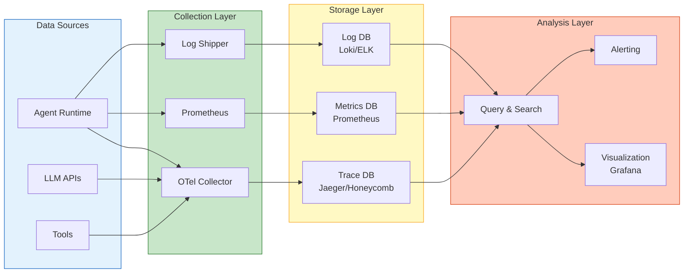
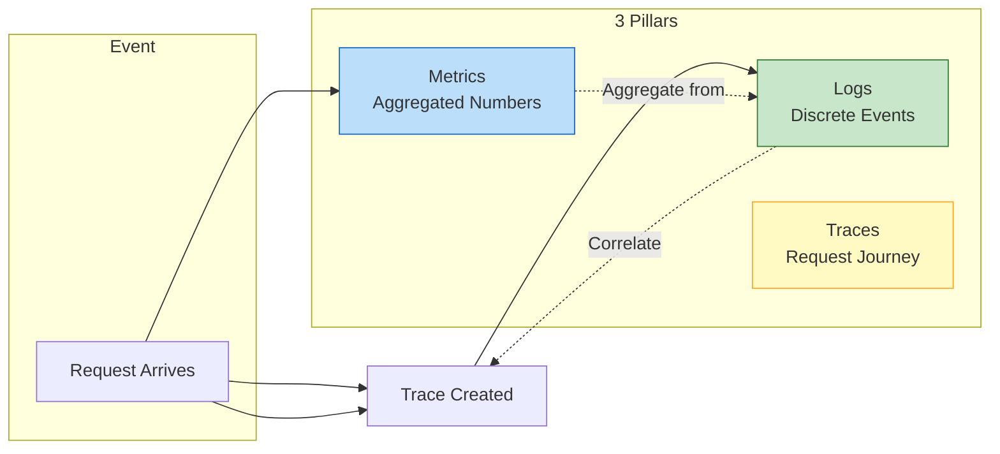
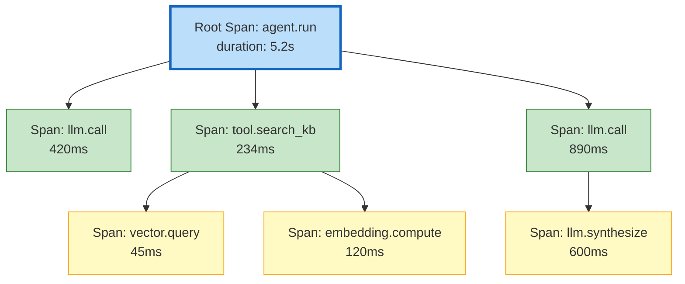
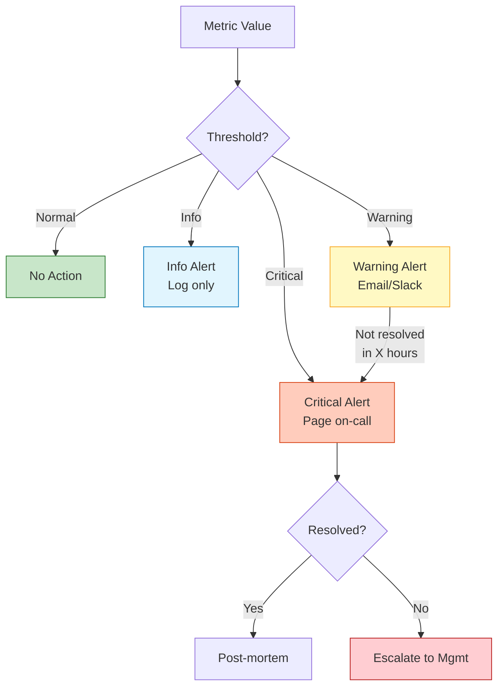

# Day 13 — Monitoring, Logging & Observability

Bản tổng hợp có hệ thống toàn bộ phương pháp luận về **Observability vs. Monitoring, 3 Pillars (Logs/Metrics/Traces), Cardinality Management, AI Metrics Deep Dive, Structured Logging, Distributed Tracing, SLO-based Alerting & Dashboard Design, và Tools Landscape 2026** trong chương trình **AI Thực chiến VinUni (Lớp K4A - Giảng viên: M.Sc Trần Minh Tú)**.

> [!TIP] **Tư duy Hệ thống Chỉ đạo**
> *"Monitoring trả lời câu hỏi 'hệ thống có ổn không?'. Observability trả lời câu hỏi 'vì sao hệ thống không ổn?'. Trong thế giới AI Agent — nơi mà một câu hỏi đơn lẻ có thể trigger hàng chục tool calls, vector retrievals, và LLM generations — bạn không thể chỉ monitoring được. Bạn cần observability để thực sự hiểu tại sao agent đưa ra quyết định sai."*

---

## 1. Observability vs. Monitoring

### 1.0. Tổng Quan Observability Stack



### 1.1. Định nghĩa Cốt lõi

| Khái niệm | Mô tả | Câu hỏi trả lời |
|---|---|---|
| **Monitoring** | Theo dõi các chỉ số đã định nghĩa trước, cảnh báo khi vượt ngưỡng | "Cái gì hỏng?" |
| **Observability** | Khả năng hiểu trạng thái nội bộ và lý do từ dữ liệu phát ra | "Tại sao hỏng?" |

### 1.2. Known-Unknowns vs. Unknown-Unknowns

| Loại | Thuộc về | Ví dụ |
|---|---|---|
| **Known-Knowns** | Monitoring đủ | Error rate tăng, latency spike |
| **Known-Unknowns** | Monitoring + Dashboards | Biết có blind spots, monitor những thứ quan trọng nhất |
| **Unknown-Unknowns** | Cần Observability | "Vì sao agent gọi tool này 7 lần rồi vẫn trả lời sai?" |

### 1.3. Với AI Agent

```
Traditional System:
Input → Processing → Output
         │
         └──► Metrics: latency, error rate ✓

Agent System:
Input → Reasoning Loop → Tool Calls → Output
         │
         └──► Không đủ:
              • Trace từng bước suy luận
              • Tool call sequence
              • Retrieved context quality
              • Citation validity
```

---

## 2. 3 Pillars + Profiles

### 2.0. Mối Liên Hệ Giữa 3 Pillars



### 2.1. Logs — Sự kiện rời rạc

| Thuộc tính | Mô tả |
|---|---|
| **Câu hỏi** | "Chuyện gì đã xảy ra?" |
| **Tính chất** | Discrete events với timestamp |
| **Volume** | High cardinality possible |
| **Lưu trữ** | ELK Stack, Loki, CloudWatch |

**Ví dụ với Agent:**
```
[timestamp] level=INFO agent_id=supervisor-1 action=tool_call
  tool=search_knowledgebase args={query: "refund policy"}
  result=status=success chunks_returned=5 duration_ms=234
```

### 2.2. Metrics — Số liệu tổng hợp

| Thuộc tính | Mô tả |
|---|---|
| **Câu hỏi** | "Hệ thống đang thế nào?" |
| **Tính chất** | Aggregated numerical data |
| **Volume** | Low cardinality (pre-aggregated) |
| **Lưu trữ** | Prometheus, Datadog, CloudWatch |

**Ví dụ:**
```
llm_requests_total{model="gpt-4o", status="200"} - Counter
llm_latency_seconds_bucket{model="gpt-4o", le="1.0"} - Histogram
vector_retrieval_latency_seconds{method="hybrid"} - Histogram
```

### 2.3. Traces — Cây Span của Request

| Thuộc tính | Mô tả |
|---|---|
| **Câu hỏi** | "Đi qua đâu, mất bao lâu?" |
| **Tính chất** | End-to-end request lifecycle |
| **Volume** | One trace per request |

**Ví dụ cấu trúc:**
```
trace_id: abc123
├── span: agent.run (total: 5.2s)
│   ├── span: llm.call (420ms)
│   ├── span: tool_call: search_knowledgebase (234ms)
│   │   └── span: vector_store.query (45ms)
│   └── span: llm.call (890ms)
```

---

## 3. Cardinality Management

### 3.1. Định nghĩa Cardinality

**Cardinality** = Số lượng giá trị duy nhất (unique) trong một tập dữ liệu. Trong observability, nó là số **time series duy nhất** được tạo ra.

```
Metric = Tên + Tổ hợp các label
Mỗi tổ hợp label khác nhau = 1 time series riêng

llm_requests_total{model="gpt-4", status="200"} → series 1
llm_requests_total{model="gpt-4", status="500"} → series 2
llm_requests_total{model="claude", status="200"} → series 3
```

**Cardinality của metric = Tích số giá trị của từng label:**
```
model (5) × status (4) × tool (20) = 400 series ← OK
user_id (1M) × action (100) = 100M series ← OOM!
```

### 3.2. Low vs. High Cardinality

| | Low Cardinality | High Cardinality |
|---|---|---|
| **Số giá trị** | Ít, hữu hạn, biết trước | Nhiều, tăng không giới hạn |
| **Ví dụ** | `model`, `status`, `tool_name`, `env` | `user_id`, `session_id`, `trace_id`, `prompt` |
| **Hợp với** | **Metrics** | **Traces / Logs** |

### 3.3. Cardinality Explosion — Vấn đề

| Hậu quả | Tác động |
|---|---|
| **Chi phí storage tăng vọt** | SaaS như Datadog tính tiền theo số series |
| **Prometheus OOM** | Quá nhiều time series vượt RAM |
| **Dashboard timeout** | Query chậm hoặc fail |
| **Alert noise** | Quá nhiều alerts không liên quan |

### 3.4. Best Practices

| Nên làm | Không nên làm |
|---|---|
| Label với giá trị cố định: `env`, `region`, `service` | Label với giá trị unique: `user_id`, `request_id` |
| Sampling logs với high-cardinality fields | Đưa toàn bộ payload vào metrics labels |
| Kiểm tra cardinality trước khi thêm label | Thêm label mà không đo lường impact |

---

## 4. AI Metrics Deep Dive

### 4.1. AI-Specific Metrics Taxonomy

| Metric Category | Metrics | Description |
|---|---|---|
| **LLM Performance** | Token/s, Latency p50/p95/p99 | Tốc độ và độ trễ model |
| **Cost** | Cost/request, Cost/session | Chi phí vận hành |
| **Quality** | Faithfulness, Relevance, Citations | Chất lượng output |
| **Tool Usage** | Tool call rate, Tool success rate | Sử dụng công cụ |
| **Retrieval** | Hit rate, Chunk quality | Tìm kiếm vector |

### 4.2. Core AI Metrics

#### Token Metrics
```
input_tokens_total{model}
output_tokens_total{model}
cost_per_1k_tokens{model}
```

#### Latency Metrics
```
llm_latency_seconds{model, operation}
time_to_first_token_seconds
time_per_output_token
```

#### Quality Metrics
```
faithfulness_score (RAGAS)
answer_relevancy_score (RAGAS)
citation_validity_rate
groundedness_score
```

#### Agent-Specific Metrics
```
agent_loops_total
tool_call_success_rate
tool_call_failure_rate
retrieval_hit_rate
escalation_rate (HITL)
```

### 4.3. SLOs for AI Systems

| SLO | Target | Window |
|---|---|---|
| **Response Time** | p95 < 3s | 30 days |
| **Availability** | 99.9% | 30 days |
| **Faithfulness** | > 85% | 7 days |
| **Error Rate** | < 1% | 30 days |
| **Cost per Session** | < $0.10 | 30 days |

---

## 5. Structured Logging

### 5.1. Log Format Standards

**JSON Lines (JSONL) — Recommended:**
```json
{"timestamp":"2026-09-29T10:30:00Z","level":"INFO","service":"agent-runtime","trace_id":"abc123","message":"Tool call completed","tool":"search_knowledgebase","duration_ms":234,"status":"success"}
{"timestamp":"2026-09-29T10:30:01Z","level":"ERROR","service":"agent-runtime","trace_id":"abc123","message":"Tool call failed","tool":"search_knowledgebase","error":"timeout"}
```

### 5.2. Log Levels

| Level | Khi nào | Ví dụ |
|---|---|---|
| **DEBUG** | Debugging, development | Variable values, loop iterations |
| **INFO** | Normal operation | Tool calls, LLM requests, state transitions |
| **WARN** | Unexpected but handled | Retries, fallbacks, degraded mode |
| **ERROR** | Errors requiring attention | Tool failures, LLM errors, circuit breakers |

### 5.3. Correlation IDs

```python
# Request flow với correlation ID
trace_id = generate_trace_id()
context = {"trace_id": trace_id}

# Tất cả logs trong request đều có trace_id
log.info("Starting agent loop", extra=context)
log.info("Calling LLM", extra=context)
log.info("Tool call", extra={**context, "tool": "search"})
log.info("Agent completed", extra=context)
```

### 5.4. Log Sampling Strategy

| Strategy | Khi nào dùng | Implementation |
|---|---|---|
| **100% Sampling** | Errors, high-value requests | Send all logs for these |
| **Head-based** | Random sampling % | `if random() < 0.1: log()` |
| **Tail-based** | Based on outcome | Log more on errors, less on success |

---

## 6. Distributed Tracing

### 6.0. Cấu Trúc Một Trace



### 6.1. Trace Structure

```
Trace
└── Span (Root)
    ├── Span (Child 1)
    │   └── Span (Grandchild)
    └── Span (Child 2)
```

**Span attributes:**
```python
span = tracer.start_span("agent.run")
span.set_attribute("agent_id", "supervisor-1")
span.set_attribute("user_id", "user123")
span.set_attribute("model", "gpt-4o")

# Nested operations
with tracer.start_as_current_span("llm.call") as llm_span:
    llm_span.set_attribute("prompt_tokens", 500)
    llm_span.set_attribute("completion_tokens", 150)
    # LLM call...

span.end()
```

### 6.2. OpenTelemetry Integration

```python
from opentelemetry import trace
from opentelemetry.exporter.otlp.proto.grpc.trace_exporter import OTLPSpanExporter
from opentelemetry.sdk.trace import TracerProvider
from opentelemetry.sdk.trace.export import BatchSpanProcessor

# Setup
provider = TracerProvider()
processor = BatchSpanProcessor(OTLPSpanExporter(endpoint="http://collector:4317"))
provider.add_span_processor(processor)
trace.set_tracer_provider(provider)

tracer = trace.get_tracer(__name__)

# Use in code
with tracer.start_as_current_span("agent.decision") as span:
    span.set_attribute("decision.reason", "retrieval_needed")
    span.set_attribute("decision.confidence", 0.95)
```

### 6.3. AI-Specific Trace Patterns

```python
# LangGraph + OpenTelemetry integration
from langgraph.callbacks.openai import OpenAICallbackHandler

handler = OpenAICallbackHandler(tracer)

# Agent execution automatically traced
result = agent.run(
    user_input,
    callbacks=[handler]  # All LLM calls, tool calls traced
)
```

### 6.4. Trace Collection Pipeline

```
Application
    │
    ▼ (OTLP Protocol)
┌──────────────┐
│  Collector   │  (Otelcol, Vector)
└──────┬───────┘
       │
┌──────▼───────┐
│  Backend     │  (Jaeger, Tempo, Honeycomb)
└──────┬───────┘
       │
┌──────▼───────┐
│  UI/Analysis │
└──────────────┘
```

---

## 7. SLO-Based Alerting & Dashboards

### 7.0. Alert Severity Flow



### 7.1. Alert Hierarchy

| Level | Response Time | Ví dụ |
|---|---|---|
| **Critical** | Immediate | Service down, major outage |
| **Warning** | Within hours | SLO at risk, degraded performance |
| **Info** | Within days | Trends, capacity planning |

### 7.2. Alert Rules

```yaml
# Prometheus Alert Rules
groups:
  - name: agent-alerts
    rules:
      - alert: HighLLMLatency
        expr: histogram_quantile(0.95, llm_latency_seconds) > 5
        for: 5m
        labels:
          severity: warning
        annotations:
          summary: "LLM p95 latency exceeds 5s"

      - alert: LLMErrorRateHigh
        expr: rate(llm_errors_total[5m]) / rate(llm_requests_total[5m]) > 0.05
        for: 2m
        labels:
          severity: critical
        annotations:
          summary: "LLM error rate exceeds 5%"
```

### 7.3. Dashboard Design Principles

| Principle | Description |
|---|---|
| **Start with SLOs** | Dashboards should answer "Are we meeting our SLOs?" |
| **Single source of truth** | One dashboard per stakeholder type |
| **Alert-driven detail** | Dashboards should help diagnose alerts |
| **Keep it scannable** | Use color intentionally (green/yellow/red) |

### 7.4. Recommended Dashboard Panels

**Executive Dashboard:**
- Request volume & error rate
- P95 latency
- Cost per day
- User satisfaction score

**Engineering Dashboard:**
- Error rate by type
- Latency breakdown (LLM vs tools vs network)
- Token usage by model
- Tool call success/failure rates

**Agent-Specific Dashboard:**
- Loop iteration count distribution
- Retrieval hit rate over time
- Escalation rate (HITL triggers)
- Citation validity rate

---

## 8. Tools Landscape 2026

### 8.1. Observability Platforms

| Tool | Type | Best for |
|---|---|---|
| **Datadog** | Commercial SaaS | Full-stack, AI monitoring |
| **Grafana + Prometheus** | Open-source | Custom dashboards, self-hosted |
| **Honeycomb** | Commercial SaaS | Event-based, high cardinality |
| **Jaeger** | Open-source | Distributed tracing |
| **Grafana Tempo** | Open-source | Cost-effective tracing storage |
| **Langfuse** | Open-source | AI-specific traces & evals |

### 8.2. AI-Specific Tools

| Tool | Focus | Features |
|---|---|---|
| **Langfuse** | LLM tracing | Prompt management, cost tracking |
| **Phoenix (Arize)** | LLM evaluation | RAG eval, embeddings |
| **OpenTelemetry GenAI** | Standard tracing | Auto-instrumentation |
| **RAGAS** | RAG evaluation | Faithfulness, context precision |

### 8.3. Log Aggregation

| Tool | Strengths |
|---|---|
| **Elasticsearch + Kibana (ELK)** | Full-text search, large scale |
| **Loki + Grafana** | Cost-effective, Prometheus integration |
| **Splunk** | Enterprise, security |
| **CloudWatch** | AWS-native applications |

### 8.4. Correlation Matrix

| Need | Recommended Stack |
|---|---|
| Quick setup, AI-focused | Langfuse + Phoenix |
| Enterprise, full-stack | Datadog |
| Self-hosted, cost-effective | Prometheus + Grafana + Jaeger |
| AWS-native | CloudWatch + X-Ray |

---

## 9. Implementation Checklist

### 9.1. Day 1: Foundation
- [ ] Add structured logging to agent runtime
- [ ] Instrument LLM calls with tracing
- [ ] Create basic metrics (request count, latency, error rate)
- [ ] Set up alert for error rate > 1%

### 9.2. Week 1: AI-Specific
- [ ] Add tool call tracing
- [ ] Instrument retrieval quality metrics
- [ ] Add citation tracking
- [ ] Create AI-specific dashboard

### 9.3. Week 2: Advanced
- [ ] Add cost tracking per session
- [ ] Implement SLO tracking
- [ ] Add user feedback correlation
- [ ] Set up P95/P99 latency SLOs

### 9.4. Ongoing
- [ ] Weekly SLO review
- [ ] Dashboard refinement based on incidents
- [ ] Add new metrics based on emerging patterns
- [ ] Regular cost analysis and optimization

---

## Mối Liên Hệ Với Các Note Khác

- Kế thừa từ [[Day 10 - Data Pipeline Observability và Quản trị ETL]] về Data Observability
- Bổ sung cho [[Day 09 - Multi-Agent Systems và Kiến trúc Điều phối]] với trace-driven debugging
- Liên quan đến [[Day 08 - Advanced RAG Pipeline và Đánh giá Thực nghiệm]] với evaluation metrics
- Phục vụ cho capstone [[EDU-02 - Trợ lý Giảng dạy AI]] với monitoring strategy cho production system
