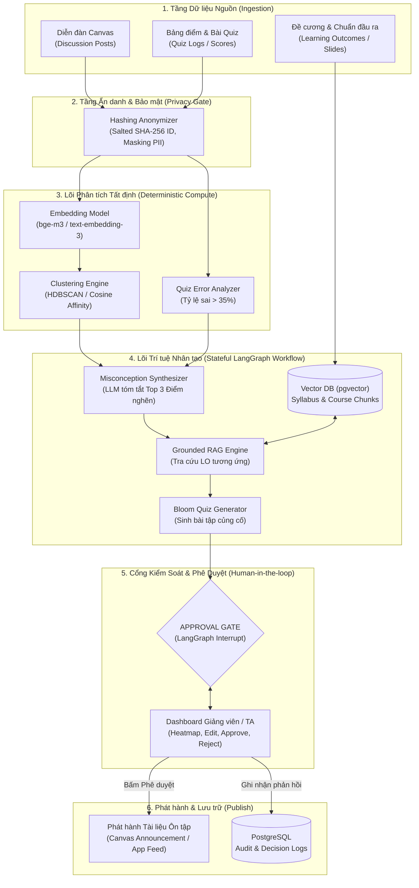
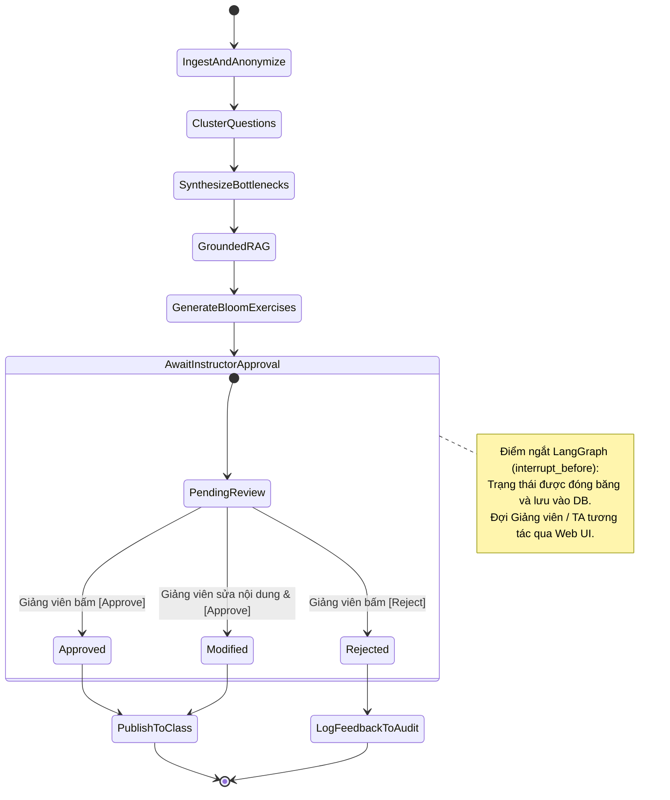

# Kiến Trúc Hệ Thống & Thiết Kế Workflow — EDU-02

Tài liệu thiết kế kỹ thuật chi tiết về kiến trúc hệ thống, quy trình luân chuyển dữ liệu và đồ thị trạng thái **LangGraph Stateful Workflow** cho đề tài **`EDU-02: Trợ lý giảng dạy AI tổng hợp vướng mắc lớp học realtime`**.

---

## 1. Sơ Đồ Kiến Trúc Tổng Thể (System Architecture)

Hệ thống được thiết kế theo mô hình phân tầng nghiêm ngặt, tách biệt giữa **Dữ liệu thô**, **Lõi tính toán tất định (Deterministic Code)**, **Lõi suy luận xác suất (LLM Reasoning)** và **Lớp kiểm duyệt con người (Human Gate)**:



---

## 2. Thiết Kế Đồ Thị Trạng Thái LangGraph (Stateful Workflow)

Áp dụng kỹ thuật điều phối quy trình đã học từ [[Day 03 - Thiết kế Workflow và Kiểm soát Hệ thống AI|Day 03]] và [[Day 04 - Prompt Engineering và Tool Calling|Day 04]]:

### 2.1. Cấu trúc State của Graph (`ClassPulseState`)
```python
from typing import TypedDict, List, Dict, Optional, Any

class ClassPulseState(TypedDict):
    course_id: str
    week_number: int
    raw_posts: List[Dict[str, Any]]
    raw_quiz_results: List[Dict[str, Any]]
    anonymized_data: List[Dict[str, Any]]
    clusters: List[Dict[str, Any]]
    top_bottlenecks: List[Dict[str, Any]]
    grounded_context: List[str]
    suggested_exercises: List[Dict[str, Any]]
    approval_status: str  # "PENDING" | "APPROVED" | "REJECTED" | "MODIFIED"
    instructor_feedback: Optional[str]
    published_payload: Optional[Dict[str, Any]]
```

### 2.2. Các Nodes & Quy trình Chuyển trạng thái


* **Node 1: `IngestAndAnonymize`:** Tiếp nhận dữ liệu từ Canvas API, thực hiện hashing SHA-256 cho `student_id`, loại bỏ email, tên riêng.
* **Node 2: `ClusterQuestions`:** Sinh embeddings cho các câu hỏi và chạy HDBSCAN để phân thành các cụm lỗi đồng nhất.
* **Node 3: `SynthesizeBottlenecks`:** LLM phân tích các cụm câu hỏi và kết quả quiz sai nhiều để rút ra **Top 3 điểm nghẽn nhận thức**.
* **Node 4: `GroundedRAG`:** Truy xuất các đoạn văn bản trong Syllabus và Slide bài giảng ứng với Learning Outcome của từng điểm nghẽn.
* **Node 5: `GenerateBloomExercises`:** Sinh 2–3 bài tập củng cố bám theo Thang đo Bloom (Nhớ $\rightarrow$ Hiểu $\rightarrow$ Vận dụng).
* **Node 6: `AwaitInstructorApproval` (APPROVAL GATE):** Dừng luồng xử lý (`interrupt_before`), chuyển quyền kiểm soát sang Web Dashboard của giảng viên.
* **Node 7: `PublishToClass`:** Sau khi được con người phê duyệt, xuất bản tài liệu ôn tập cho lớp học.

---

## 3. Bản Bắt Tay Vòng Lặp Kỹ Thuật (Tool Calling Handshake)

Áp dụng chu trình 4 bước chuẩn mực từ [[Day 04 - Prompt Engineering và Tool Calling|Day 04]]:

```sequence
User/Scheduler -> Agent: Kích hoạt tổng hợp tuần (course_id="CS101", week=3)
Agent -> LLM: Gửi Schema tra cứu tri thức môn học (lookup_course_syllabus)
LLM -> Agent: Phản hồi tool_calls: lookup_course_syllabus(topic="Gradient Descent")
Agent -> VectorDB: Query pgvector với cosine similarity + reranker
VectorDB -> Agent: Trả về 3 chunks chuẩn đầu ra và slide liên quan
Agent -> LLM: Gửi message role: "tool" chứa nội dung chunks
LLM -> Agent: Sinh bài tập ôn tập chuẩn Thang Bloom
Agent -> ApprovalGate: Lưu trạng thái PENDING, chờ Giảng viên xác nhận
```

---

## 4. Cơ Chế Phòng Ngừa Rủi Ro & Vòng Lặp An Toàn (Resilience & Safety)

1. **Circuit Breaker (Chốt ngắt lặp vô tận):**
   * Trong chu trình RAG và tổng hợp, giới hạn tối đa `max_turns = 3`. Nếu sau 3 lượt mà mô hình không sinh được bài tập đúng chuẩn, hệ thống tự động fallback: chỉ xuất trình tóm tắt điểm nghẽn và để giảng viên tự soạn câu hỏi.
2. **Fail-Safe Data Ingestion:**
   * Toàn bộ các lượt gọi Canvas API được bao bọc trong khối `try...except`. Nếu Canvas API gặp lỗi timeout hoặc mất mạng, hệ thống sử dụng bản cache cục bộ gần nhất và thông báo rõ ràng cho giảng viên.
3. **Idempotency trong Giao tác Xuất bản (Publish Idempotency):**
   * Mỗi phiên gợi ý bài tập tuần có một mã duy nhất (`session_id = course_id + week + batch_timestamp`). Việc giảng viên bấm nút [Approve] nhiều lần sẽ không bao giờ tạo ra các thông báo hay bài tập trùng lặp trên giao diện sinh viên.
