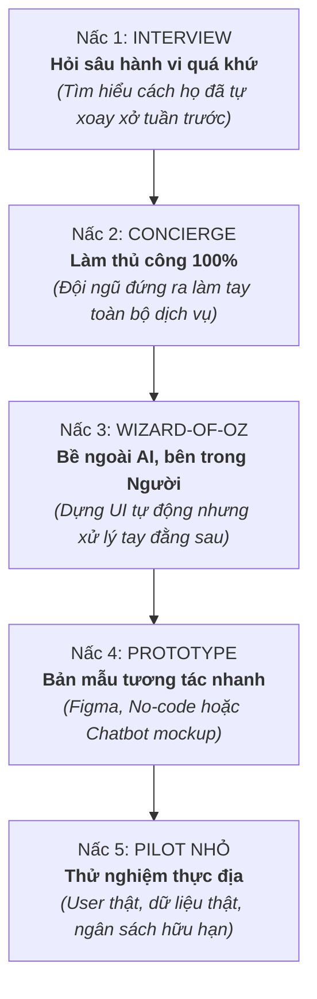

# Workshop Tối Day 04 — Xây Dựng AI MVP & Thang Đo Kiểm Chứng

Bản tổng hợp có hệ thống toàn bộ phương pháp luận về **Định vị Persona, Bóc tách Problem gốc, Bản đồ Đòn bẩy AI (AI Leverage Map), AI MVP Canvas và Thang kiểm chứng (Validation Ladder)** từ buổi **Workshop Chuyên đề Tối Day 04 (8:00 PM – 10:00 PM)** thuộc chương trình **AI Thực chiến VinUni (Lớp K4A)**.

> [!TIP] **Tư duy Hệ thống Chỉ đạo**
> *"Ý tưởng tốt không phải là ý tưởng hoành tráng. Ý tưởng tốt là ý tưởng có thể kiểm chứng nhanh và cắt bỏ sai lầm nhanh. Người dùng không mua công nghệ AI, họ mua kết quả cuối cùng (Outcome). Trước khi viết prompt hay code bất kỳ dòng AI nào, bạn phải biết rõ ai đang đau, đau vì sao, AI tạo đòn bẩy thật ở đâu, và phạm vi nhỏ nhất (What NOT to build) để kiểm chứng giá trị sống còn."*

---

## 1. Khung Sườn Chỉ Đạo 5 Bước (Core Framework)

Mọi dự án AI MVP thực chiến đều phải đi qua chuỗi logic 5 chặng chặt chẽ:

```text
┌───────────┐      ┌───────────┐      ┌───────────────┐      ┌─────────────┐      ┌──────────┐
│  PERSONA  │ ───> │  PROBLEM  │ ───> │  AI LEVERAGE  │ ───> │  MVP SCOPE  │ ───> │  METRIC  │
└───────────┘      └───────────┘      └───────────────┘      └─────────────┘      └──────────┘
  Nhóm hẹp           Nỗi đau gốc        Đòn bẩy thật           Cắt bỏ rườm rà       Đo lường
  đủ để cắt          không phải         không làm màu          What NOT             Outcome
  tính năng          triệu chứng        lúc demo               to build             thật
```

1. **Persona:** Chọn nhóm người dùng đủ hẹp để có thể đưa ra quyết định cắt giảm tính năng một cách dứt khoát.
2. **Problem:** Bóc tách bài toán đến tận nguyên nhân cơ chế gốc rễ, không dừng lại ở các triệu chứng bề nổi.
3. **AI Leverage:** Xác định chính xác AI tạo ra giá trị khác biệt ở đâu (tốc độ, độ chính xác, cá nhân hóa) hay chỉ là lớp trang trí.
4. **MVP Scope:** Khoanh vùng phạm vi nhỏ nhất có thể để kiểm chứng giả thuyết sống còn; xác định rõ ranh giới *What NOT to build*.
5. **Metric:** Thiết lập thước đo định lượng phản ánh đúng giá trị người dùng nhận được, thay vì đo lường sự tò mò hay số lượt click ảo.

---

## 2. Persona Sắc Bén: Công Cụ Để Ra Quyết Định Cắt Bỏ Tính Năng

```text
                          ┌──────────────┐
                          │   Nên bỏ gì? │
                          └──────┬───────┘
                                 │
     ┌──────────────┐     ┌──────▼──────┐     ┌──────────────┐
     │ Nên build gì?│ <───┤   PERSONA   ├───> │Nên phỏng vấn │
     └──────────────┘     │   SẮC BÉN   │     │    ai?       │
                          └──────┬──────┘     └──────────────┘
                                 │
                   ┌─────────────┴─────────────┐
                   ▼                           ▼
          ┌────────────────┐          ┌──────────────────┐
          │ Nên đo lường gì?│         │Nên thiết kế trải │
          └────────────────┘          │  nghiệm ra sao?  │
                                      └──────────────────┘
```

* **Nguyên lý cốt lõi:** *"Persona càng hẹp, quyết định sản phẩm càng sắc."*
* Persona trong phát triển sản phẩm AI không phải là bản sơ yếu lý lịch chung chung (như "nhân viên văn phòng 25–40 tuổi"). Đó là một bức chân dung cụ thể về **hành vi, bối cảnh chịu áp lực và giới hạn nhận thức** của người dùng.
* **5 Câu hỏi sống còn mà một Persona sắc bén giúp trả lời:**
  1. **Nên build gì?** — Tập trung tuyệt đối vào tính năng then chốt giúp họ vượt qua rào cản.
  2. **Nên bỏ gì?** — Dũng cảm loại bỏ 80% tính năng "nghe có vẻ hay" nhưng không giải quyết nỗi đau trực tiếp.
  3. **Nên đo lường gì?** — Chọn đúng chỉ số phản ánh sự thay đổi hành vi hoặc hiệu quả của họ.
  4. **Nên phỏng vấn ai?** — Tiếp cận đúng người đang thực sự chịu đau hàng ngày để thẩm định.
  5. **Nên thiết kế trải nghiệm ra sao?** — Tối ưu hóa giao diện và mức độ can thiệp (friction) phù hợp với bối cảnh sử dụng thực tế.

---

## 3. Bóc Tách Bài Toán: Problem Không Phải Là Triệu Chứng

Sai lầm phổ biến nhất khiến các đội ngũ kỹ thuật "đốt tiền" vào AI là **nhầm lẫn giữa triệu chứng nhìn thấy và căn nguyên gốc rễ**. Giải quyết triệu chứng chỉ tạo ra những tính năng chắp vá; giải quyết vấn đề gốc mới tạo ra sản phẩm bền vững.

| Triệu chứng bề mặt *(Thứ nhìn thấy)* | Căn nguyên gốc rễ *(Thứ phải đào sâu giải quyết)* | Hướng tiếp cận kỹ thuật / Sản phẩm đúng |
|---|---|---|
| **Người học lười biếng** | **Thiếu môi trường duy trì hành vi** | Không phải tạo thêm bài tập hay gamification giả tạo; cần tạo áp lực xã hội tích cực (Social commitment) hoặc môi trường học đồng hành có nhắc nhở thông minh. |
| **Giáo viên mất nhiều thời gian** | **Quy trình thủ công bị lặp lại** | Tự động hóa các khâu chấm lỗi cú pháp/định dạng cơ bản, giải phóng giáo viên để họ tập trung vào phản hồi chiều sâu. |
| **Sales quên follow-up khách hàng** | **Thiếu thông tin đúng lúc để ra quyết định** | Tóm tắt lịch sử tương tác và tự động đưa ra gợi ý hành động tiếp theo (Nudge) ngay trước thời điểm vàng. |
| **Khách hàng không quay lại** | **Không có trigger đủ mạnh để kéo họ trở lại** | Thiết lập trigger gắn liền với sự kiện thực tế trong đời sống/công việc của họ, thay vì spam thông báo vô nghĩa. |

---

## 4. Công Thức Chuẩn Hóa Problem Statement

> [!TIP] **Khẩu quyết Kỹ nghệ Sản phẩm**
> *"Viết đúng nỗi đau trước khi viết prompt."*

### 4.1. Cấu trúc 5 thành phần chuẩn hóa
$$\text{[Persona]} \text{ gặp khó khăn khi } \text{[Job-to-be-done]} \text{ trong bối cảnh } \text{[Context]}, \text{ hiện họ đang } \text{[Current workaround]}, \text{ dẫn đến } \text{[Negative outcome]}.$$

### 4.2. Phân tích Case Study Thực Tế (Tự học buổi tối)
* **Persona:** `[Sinh viên 18–24 tuổi]`
* **Job-to-be-done:** `[tự học một mình vào buổi tối]`
* **Context:** `[có quá nhiều yếu tố gây xao nhãng từ mạng xã hội, điện thoại và môi trường xung quanh]`
* **Current workaround:** `[bật video study-with-me trên YouTube, dùng app Pomodoro rời rạc hoặc rủ bạn học cùng qua Discord]`
* **Negative outcome:** `[mất tập trung, các phiên học diễn ra chắp vá, không duy trì được thói quen và suy giảm động lực đường dài]`.

---

## 5. Bản Đồ Đòn Bẩy AI (AI Leverage Map)

AI chỉ có ý nghĩa khi nó đóng vai trò là **đòn bẩy (Leverage)** giải quyết bài toán nhanh hơn, chuẩn xác hơn hoặc cá nhân hóa hơn. Nếu không, AI chỉ là gánh nặng chi phí và rủi ro vận hành.

```text
┌────────────────────────────────────────┬────────────────────────────────────────┐
│  1. TỐC ĐỘ (Speed / Efficiency)        │  2. ĐỘ CHÍNH XÁC (Decision Support)    │
│  AI giúp người dùng hoàn thành         │  AI tổng hợp dữ liệu giúp quyết định   │
│  tác vụ gì nhanh gấp 10 lần?           │  nào sáng suốt và giảm thiểu sai sót?  │
│  (Ví dụ: Tóm tắt văn bản, draft code)  │  (Ví dụ: Cảnh báo rủi ro, phân loại)   │
├────────────────────────────────────────┼────────────────────────────────────────┤
│  3. CÁ NHÂN HÓA (Personalization)      │  4. BỘ LỌC THỰC CHẤT (Necessity Check) │
│  AI giúp trải nghiệm nào được may đo   │  AI có THỰC SỰ cần thiết không hay     │
│  riêng theo trình độ và ngữ cảnh?      │  chỉ là lớp trang trí làm màu lúc demo?│
│  (Ví dụ: Lộ trình học linh hoạt)       │  (Nếu rule/if-else giải quyết được -> BỎ)│
└────────────────────────────────────────┴────────────────────────────────────────┘
```

* **Quy tắc bài trừ Gimmick (Ô số 4):** Nếu bài toán có thể giải quyết ổn thỏa bằng thuật toán truyền thống, logic `if-else` hoặc biểu mẫu có cấu trúc, hãy **ưu tiên giải pháp không dùng AI**. Chỉ đưa LLM/AI vào những mắt xích xử lý ngôn ngữ tự nhiên mở, tri thức phi cấu trúc hoặc suy luận phức tạp.

---

## 6. Định Vị Giá Trị: AI Không Phải Là Value Proposition

> [!IMPORTANT] **Quy luật Tiếp nhận Sản phẩm**
> *"Người dùng không quan tâm bạn dùng bao nhiêu tham số mô hình hay công nghệ AI tối tân nào. Họ chỉ quan tâm kết quả đầu ra (Outcome) có giúp cuộc sống của họ bớt đau đớn hay không."*

* **Tuyên ngôn lỗi thời (Tech-first / Feature-centric) [Tránh dùng]:**
  > *"Chúng tôi là nền tảng học tập ứng dụng trí tuệ nhân tạo (AI-powered Learning Platform)."*
  * *Hậu quả:* Không mang lại bất kỳ thông điệp giá trị nào. Người dùng không biết họ nhận được gì ngoài một con chatbot chung chung.
* **Tuyên ngôn chuẩn mực (Outcome-first / User-centric) [Khuyên dùng]:**
  > *"Chúng tôi giúp sinh viên duy trì phiên tự học lâu hơn nhờ môi trường học cùng người khác và hệ thống nhắc nhở thông minh đúng thời điểm."*
  * *Sức mạnh:* Định vị rõ ràng ai là đối tượng hưởng lợi, outcome đo lường được là gì (thời gian duy trì phiên học), và cơ chế tạo giá trị thực tế.

---

## 7. Thẩm Định Tính Khả Thi Của AI (AI Feasibility Check)

Trước khi bắt tay vào triển khai kỹ thuật, hệ thống phải được đánh giá qua **Radar 6 chiều**:

```text
                 [ Data ]
                    ▲
                    │
[ Human-in-the-loop]┼───[ Accuracy ]
                    │
            [ Trust ]───[ Latency ]
                    │
                 [ Cost ]
```

1. **Data (Dữ liệu đầu vào):** Dữ liệu có sẵn sàng, đủ sạch, đủ đại diện và có bản quyền hợp pháp không? *"Garbage In, Hallucination Out"*.
2. **Accuracy (Độ chính xác & Dung sai lỗi):** Ngân sách lỗi (*Error Budget*) của bài toán là bao nhiêu? Hậu quả khi AI trả lời sai là gì? Sai sót có làm mất tiền hay nguy hiểm đến tính mạng người dùng không?
3. **Latency (Độ trễ phản hồi):** Người dùng có chấp nhận chờ 5–15 giây cho một lượt suy luận Agent không? Nếu bài toán yêu cầu phản hồi tức thì (< 500ms), kiến trúc Agent đa bước sẽ thất bại.
4. **Cost (Chi phí vận hành & Unit Economics):** Doanh thu hoặc giá trị tạo ra từ mỗi lượt xử lý có lớn hơn chi phí token API gọi mô hình không?
5. **Trust (Độ tin cậy & Giải trình):** Người dùng có tin tưởng vào đề xuất của AI không? Hệ thống có cung cấp trích dẫn nguồn (Citations / Grounding) để người dùng kiểm chứng không?
6. **Human-in-the-loop (Chốt chặn phê duyệt):** Có cần con người duyệt trước khi hệ thống thực thi các hành động ghi (Write Actions) làm biến đổi trạng thái thật (gửi email, trừ tiền, xóa dữ liệu) không?

---

## 8. Bản Đồ Tác Chiến: AI MVP Canvas & Thang Kiểm Chứng

### 8.1. AI MVP Canvas (10 Ô Tinh Gọn Trên 1 Trang Giấy)

| Ô số | Trường thông tin | Nội dung chi tiết cần điền |
|:---:|---|---|
| **1** | **Target User** | Nhóm người dùng mục tiêu cụ thể, có áp lực rõ ràng. |
| **2** | **Job-to-be-done** | Công việc họ đang nỗ lực hoàn thành trong thực tế. |
| **3** | **Pain thật** | Nỗi bức xúc lớn nhất cản trở họ hoàn thành công việc. |
| **4** | **Current Workaround** | Cách họ đang chắp vá, tự xoay xở hiện tại để đối phó. |
| **5** | **Problem Statement** | Câu tuyên bố bài toán chuẩn hóa theo công thức 5 thành phần. |
| **6** | **Core Outcome** | Kết quả cụ thể, đo lường được mà giải pháp cam kết mang lại. |
| **7** | **AI Leverage** | Vai trò đòn bẩy cụ thể của AI (Speed, Decision, Personalization). |
| **8** | **MVP Scope** | Phạm vi tính năng tối thiểu để kiểm chứng lời hứa giá trị. |
| **9** | **What NOT to build** | Ranh giới dứt khoát những thứ **tuyệt đối không làm** trong bản MVP. |
| **10** | **Validation Metric** | Chỉ số đo lường sự thành bại (Retention, Task Completion Rate...). |

> [!WARNING] **Cứu Tinh Của Dự Án: Ô số 9 (What NOT to build)**
> Ranh giới không làm quan trọng hơn việc làm. Hầu hết các dự án MVP thất bại vì chết chìm trong "bẫy thêm tính năng" (Scope Creep). Xác định rõ những gì KHÔNG làm giúp team release sản phẩm trong vài ngày thay vì vài tháng.

### 8.2. The Validation Ladder (Thang Kiểm Chứng 5 Nấc)

Quy trình leo thang thực nghiệm giúp đội ngũ thẩm định nhu cầu thị trường trước khi đầu tư chi phí kỹ thuật lớn:



* **Nấc 1 (Interview):** Phỏng vấn trực diện về hành vi đã diễn ra trong quá khứ. Tuyệt đối tránh hỏi những câu hỏi giả định tương lai như *"Nếu chúng tôi làm tính năng này bạn có thích không?"*.
* **Nấc 2 (Concierge):** Không viết một dòng code nào. Đội ngũ tự tay đóng vai trò là "hệ thống" phục vụ từng khách hàng từ đầu đến cuối để thấu hiểu trọn vẹn điểm nghẽn và cảm xúc của họ.
* **Nấc 3 (Wizard-of-Oz):** Tạo một giao diện trông có vẻ tự động hóa bằng AI, nhưng toàn bộ logic phía sau vẫn do con người thực thi thủ công. Mục đích: đo lường xem người dùng có thực sự click, đăng ký hoặc sẵn sàng trả tiền hay không trước khi tốn công xây dựng pipeline AI.
* **Nấc 4 (Prototype):** Dựng bản mẫu tương tác đơn giản bằng Figma hoặc prompt flow cơ bản để kiểm tra độ mượt mà của luồng tương tác.
* **Nấc 5 (Pilot nhỏ):** Đưa sản phẩm chạy thử với nhóm người dùng hạn chế (ví dụ 10–20 người dùng thân thiết) với đầy đủ cơ chế đo lường và logging.

---

## 9. Bảng Chấm Điểm AI MVP Scorecard

Trước khi gõ dòng code đầu tiên, hãy đưa ý tưởng qua bộ lọc thẩm định 6 tiêu chí (chấm theo thang điểm từ 1 đến 5):

```rich-table
---
version: 2
title: "BẢNG CHẤM ĐIỂM AI MVP SCORECARD"
columns:
  - id: c_000001
    name: "Tiêu chí"
    width: 200
  - id: c_000002
    name: "Câu hỏi chất vấn sống còn"
    width: 440
  - id: c_000003
    name: "Thang điểm"
    width: 120
    align: center
rows:
  - id: r_000001
    cells:
      c_000001: "1. Problem Clarity"
      c_000002: "Có rõ ai đau, đau khi nào, và đau vì sao không?"
      c_000003: "1 - 5"
  - id: r_000002
    cells:
      c_000001: "2. Persona Sharpness"
      c_000002: "Persona có đủ hẹp để ra quyết định cắt tính năng không?"
      c_000003: "1 - 5"
  - id: r_000003
    cells:
      c_000001: "3. AI Leverage"
      c_000002: "AI có tạo lợi thế thật sự hay chỉ làm đẹp lúc demo?"
      c_000003: "1 - 5"
  - id: r_000004
    cells:
      c_000001: "4. MVP Focus"
      c_000002: "Scope có đủ nhỏ để kiểm chứng cực nhanh không?"
      c_000003: "1 - 5"
  - id: r_000005
    cells:
      c_000001: "5. Metric Quality"
      c_000002: "Metric đo value nhận được, hay chỉ đo sự chú ý bề nổi?"
      c_000003: "1 - 5"
  - id: r_000006
    cells:
      c_000001: "6. Feasibility"
      c_000002: "Có sẵn data, quy trình và tập user để thử nghiệm ngay?"
      c_000003: "1 - 5"
---
```

> [!TIP] **Tiêu Chuẩn Vàng Khi Chấm Điểm**
> Nếu có bất kỳ tiêu chí nào đạt dưới 3 điểm, **tuyệt đối không được phép bắt đầu code**. Cần quay lại bước phỏng vấn hoặc định vị lại bài toán cho đến khi toàn bộ các tiêu chí đều đạt độ chín muồi.

---

## 10. Ứng Dụng Thực Chiến Vào Đề Tài Nhóm 2 (Giải Mã Công Thức Toán AI)

Áp dụng toàn bộ Canvas và Validation Ladder vào đề tài của Nhóm 2 tại Bootcamp:

* **1. Target User:** Sinh viên nghiên cứu / Học viên cao học ngành AI/Data Science đang đọc các paper học thuật Deep Learning phức tạp.
* **2. Job-to-be-done:** Đọc hiểu và giải mã các công thức toán đa tầng (ví dụ: loss function trong DDPM, attention map trong Transformer) để implement lại code.
* **3. Pain thật:** Ký hiệu toán học bị biến đổi và mất dấu qua nhiều trang; các công cụ hiện nay (SciSpace, Mathpix) chỉ giải thích rời rạc từng ký tự mà không liên kết được mạch biến đổi đại số xuyên suốt bài báo.
* **4. Current Workaround:** Tự tra cứu thủ công qua Google, chat với ChatGPT chung chung (thường bị hallucination vì thiếu ngữ cảnh toàn bài báo) hoặc đọc các blog giải thích code của cộng đồng.
* **5. Problem Statement:**
  > *`[Sinh viên nghiên cứu AI]` gặp khó khăn khi `[giải mã các công thức toán đa bước trong paper]` trong bối cảnh `[ký hiệu bị phân mảnh và thay đổi qua nhiều trang]`, hiện họ đang `[tra cứu thủ công và chat với LLM rời rạc]`, dẫn đến `[hiểu sai bản chất toán học, mất hàng tuần để debug code mô hình]`.*
* **6. AI Leverage:** Truy xuất đồ thị tri thức đa bước (**GraphRAG**) để bảo toàn ngữ cảnh ký hiệu toán học xuyên trang — điều mà Vector RAG thông thường thất bại.
* **7. What NOT to build trong MVP:**
  * Không xây dựng trình render LaTeX đẹp mắt hay app mobile phức tạp.
  * Không hỗ trợ giải toán tự động hay sinh code toàn bộ paper.
  * Chỉ tập trung vào duy nhất một tính năng: **Giải thích nguồn gốc và mối liên kết của một biến số được chọn trong công thức toán về đúng định nghĩa ban đầu của nó trong paper**.
* **8. Validation Ladder cho Nhóm:**
  * *Step 1 (Interview):* Phỏng vấn 5 bạn học viên trong lớp về 3 paper cụ thể (Transformer, DDPM, YOLOv8).
  * *Step 2 (Concierge):* Nhóm tự tay lập bản đồ liên kết biến số của 1 công thức toán trên giấy và đưa cho người dùng đọc thử xem họ có hiểu nhanh hơn không.
  * *Step 3 (Pilot):* Chạy thử nghiệm trên 3 paper đồ án đã chọn để đánh giá độ chuẩn xác.

---

## 11. Mạng Lưới Tri Thức & Liên Kết Zettelkasten

* **Dự án điều phối:** [[VinUni - Chương trình Đào tạo AI Thực chiến]]
* **Các bài học liền kề:**
  * [[Day 02 - Tìm đúng bài toán cho AI]]: Khảo sát 10 điểm đau và định dạng Problem Statement v1.
  * [[Day 03 - Thiết kế Workflow và Kiểm soát Hệ thống AI]]: Bản đồ Current vs Future State và 3 Pattern kiến trúc workflow.
  * [[Day 04 - Prompt Engineering và Tool Calling]]: Kỹ nghệ Prompt as Code, Context Engineering và Tool Handshake.
* **Khái niệm cốt lõi (`04 - Notes/Concepts/`):**
  * [[AI MVP Canvas]] — Khung cấu trúc 10 ô tinh gọn thẩm định ý tưởng sản phẩm AI trên 1 trang giấy.
  * [[The Validation Ladder]] — Thang đo thực nghiệm 5 nấc từ phỏng vấn đến pilot thực tế.
  * [[AI Leverage Map]] — Ma trận 4 góc phần tư định vị đòn bẩy thực chất của AI.
  * [[AI Feasibility Check]] — Radar chart 6 chiều kiểm soát rủi ro kỹ thuật và dung sai lỗi.
* **Mệnh đề tri thức nguyên tử (`04 - Notes/Atomic/`):**
  * [[Người dùng không mua AI mà mua kết quả giải quyết vấn đề]]
  * [[Persona càng hẹp thì quyết định cắt giảm tính năng sản phẩm càng sắc bén]]
  * [[Problem gốc phản ánh cơ chế vận hành trong khi triệu chứng chỉ là biểu hiện bề mặt]]
  * [[Xác định những gì không làm là chốt chặn quan trọng nhất để bảo vệ AI MVP]]
